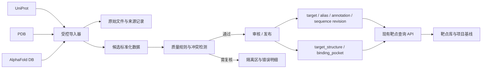
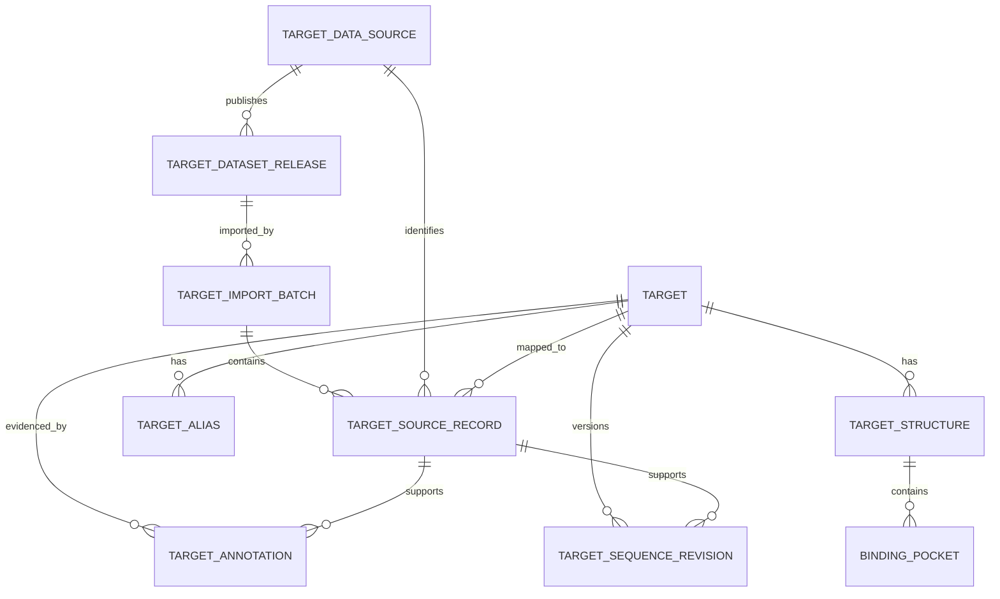

# 靶点库数据仓库设计说明书

> **文档版本**：v1.0
> **日期**：2026-10-27
> **状态**：设计基线，待评审后实施
> **适用范围**：SynPharm 靶点库、靶点结构、结合口袋及其数据接入链路
> **关联文档**：[数据层详细设计](./01-数据层详细设计.md)、[接口层详细设计](./02-接口层详细设计.md)、[OpenAPI 契约](./openapi.yaml)

---

## 1. 设计摘要

本方案把现有靶点库从“可查询的靶点、结构和口袋业务表”提升为**带来源追溯、可重复清洗、可审核发布、可按版本复现**的靶点数据仓库。

首期以现有 MySQL 业务数据库和 `synpharm-core` 服务为基础，不新增独立数仓产品。新增不可变的数据来源、版本、批次、来源记录、字段证据和序列版本；现有 `target`、`target_structure`、`binding_pocket` 继续作为兼容现有页面和项目基线的标准数据投影。大文件和原始数据包存储在对象存储或现有文件资产设施中，关系库只保存元数据、索引和引用。

首期链路：

```text
UniProt / PDB / AlphaFold DB
          │
          ▼
原始文件与批次登记（保留版本、校验值、许可及来源）
          │
          ▼
解析、映射、标准化、去重、质量检查
          │
          ├── 待审核 / 拒绝（保留错误，不发布）
          ▼
审核通过的标准靶点与结构数据
          │
          ├── target / target_structure / binding_pocket（兼容查询与设计流程）
          └── 来源记录 / 字段证据 / 序列版本（追溯、复现与审计）
```

首期数据源顺序：**UniProt → PDB → AlphaFold DB**。UniProt 是靶点身份与序列的主要锚点；PDB 和 AlphaFold DB 作为结构来源分别保存，不能互相覆盖。ChEMBL、BindingDB、ZINC、TDC 等化合物或活性数据属于后续扩展，不纳入本次靶点仓库的数据事实范围。

## 2. 现状与问题

### 2.1 已有能力

- 前端 [Targets.vue](../../../../synpharm-frontend/src/views/Targets.vue) 提供靶点检索、详情、结构/口袋展示和项目创建入口；页面说明当前靶点与结构为只读数据。
- [TargetController.java](../../../../synpharm-core/src/main/java/com/synpharm/design/api/TargetController.java) 已提供靶点分页列表、详情和结构口袋只读接口。
- [TargetAppServiceImpl.java](../../../../synpharm-core/src/main/java/com/synpharm/design/application/impl/TargetAppServiceImpl.java) 分页查询靶点，并批量装配结构及口袋，避免列表 N+1 查询。
- [14_target.sql](../../../sql/14_target.sql) 已保存 UniProt ID、名称、基因、物种、分类、疾病领域、序列、逗号分隔的 PDB ID、状态和一个来源字段。
- [15_target_structure.sql](../../../sql/15_target_structure.sql) 已区分 PDB、AlphaFold 和用户上传结构，并以 `(target_id, source, source_key)` 去重。
- [16_binding_pocket.sql](../../../sql/16_binding_pocket.sql) 保存口袋几何信息、方法和残基 JSON；现有靶点库端到端脚本验证靶点—结构—口袋链路。
- 项目与靶点绑定由 `project_target` 承担；靶点作为共享参考数据，不归属于单个用户或项目。

### 2.2 数据仓库化缺口

1. `target.source` 是单值，不能表达不同字段分别来自 UniProt、人工校订或其他来源。
2. 缺少数据集版本、导入批次、原始文件校验值、错误明细和重复导入记录，不能稳定复现或审计导入。
3. 当前规范字段直接落在业务表，缺少独立的候选、质量检查、审核和发布边界。
4. `related_diseases`、`known_drugs` 等多值信息以文本汇总，难以规范检索、追溯单项证据或增量合并。
5. 序列仅保留当前值，没有版本历史与规范化摘要；结构源版本、文件校验和结构质量状态也需要纳入统一追踪。
6. 列表页面当前一次请求最多 200 条并进行客户端筛选；数据规模扩大后应使用服务端分页和筛选，且详情读取不应强制携带全量大对象。

> 本文是面向后续实施的设计，不表示上述缺口已修复。实施前应对照实际部署数据库核对 DDL。现有 `14_target.sql` 的 `USE synpharm_core` 与 Java 实体注释中的 schema 描述存在不一致，须在迁移评审中确认数据库实际归属，不能通过本文假设自动变更。

## 3. 目标、范围与原则

### 3.1 目标

- 建立靶点身份、序列、结构和口袋数据的可追溯标准底座。
- 支持来源版本管理、可重入导入、清洗校验、人工复核、幂等发布和错误重试。
- 保留现有查询 API 形状和项目基线读取行为；数据不满足质量门槛时不静默发布。
- 能从标准记录追溯来源数据集、记录标识、导入批次、原始文件和字段级证据。
- 同一数据集版本、清洗规则版本和发布批次可重复生成相同的标准结果。

### 3.2 首期范围

- 外部来源：UniProt、PDB、AlphaFold DB。
- 数据实体：靶点主档、名称/别名、序列版本、结构及结构文件元数据、结构与靶点映射、导入与质量结果。
- 页面：现有靶点检索/详情；增加数据质量与来源信息的只读展示。管理操作优先通过受控批处理入口执行。
- 接口：兼容已有查询端点；新增导入批次、数据版本和质量状态查询能力。
- 存储：沿用现有 MySQL；大型序列快照、PDB/mmCIF 文件和原始源文件使用对象存储或 `file_asset` 体系。

### 3.3 不在首期范围

- 全量 PubChem、ZINC、ChEMBL、BindingDB 等化合物/活性仓库。
- 组织级数据湖、独立 OLAP 集群、实时流处理和自动化分子分析计算。
- 自动化靶点可药性结论或由模型生成靶点优先级。
- 将预测结构标记为实验结构、对缺失证据做推断或把冲突来源静默合并。

### 3.4 设计原则

1. **来源不可丢**：原始值与标准值并存；标准化不能覆盖原始证据。
2. **实体与来源分离**：一个规范靶点可关联多个来源记录；不以来源记录 ID 取代 UniProt 等业务身份。
3. **导入幂等**：同一来源、版本、稳定记录键和内容摘要重复导入不产生重复标准记录。
4. **先验证后发布**：候选数据、复核数据和已发布数据状态分离。
5. **冲突显式处理**：来源冲突进入待复核；不按“最后写入者覆盖”处理关键字段。
6. **科研可复现**：冻结的项目基线继续保存当时使用的靶点/结构/口袋快照或其不可变引用，不随后续仓库更新而悄然变化。
7. **兼容现有主链**：保留 `target.id`，不重建项目绑定，不更改现有 `/api/design/targets` 的基础字段语义。

## 4. 逻辑架构与数据流



### 4.1 分层定义

| 层 | 内容 | 可变性 | 存储建议 |
|---|---|---|---|
| 来源登记层 | 来源、许可、版本、抓取时间、文件摘要、导入批次 | 追加；批次状态可更新 | MySQL 元数据 |
| 原始层 | 原始 JSON/XML/TSV、PDB/mmCIF、源下载清单 | 不可覆盖；新版本新增对象 | 对象存储或文件资产 |
| 候选/隔离层 | 解析结果、映射候选、质量问题、复核状态 | 批次内可修正；保留操作日志 | MySQL staging 表；大字段外置 |
| 标准层 | 去重后靶点、别名、字段证据、序列版本、结构及口袋 | 版本化维护；已发布历史可追溯 | 现有 MySQL |
| 服务层 | 查询视图和 API DTO | 按兼容契约演进 | `synpharm-core` 查询服务 |

首期不需要另建数据仓库服务器。标准层与靶点业务表共用现有 MySQL 部署，采用独立数据表与导入权限边界；后续达到规模或分析负载门槛后再评估读副本/分析存储。

## 5. 数据模型设计

### 5.1 实体关系



图中 `TARGET`、`TARGET_STRUCTURE`、`BINDING_POCKET` 为现有核心实体；其余表是建议新增的数据治理与来源追溯表。

### 5.2 表清单

| 表 | 类型 | 用途 | 关键唯一性/索引 |
|---|---|---|---|
| `target_data_source` | 新增，可变主数据 | UniProt/PDB/AlphaFold 等来源的标识、类型、许可说明、条款 URL、允许用途与启用状态 | `source_code` 唯一 |
| `target_dataset_release` | 新增，版本记录 | 来源发布版本、获取时间、下载 URI、文件 SHA-256、许可快照及发布说明 | `(source_id, release_key)` 唯一 |
| `target_import_batch` | 新增，批次状态 | 一次导入的规则版本、状态、计数、耗时、错误摘要、触发者 | `batch_no` 唯一；按来源、状态和时间索引 |
| `target_source_record` | 新增，追加型来源映射 | 来源稳定记录键、原始记录摘要/文件引用、规范实体 ID、映射状态和出现版本 | `(source_id, source_record_key, release_id)` 唯一；`target_id` 索引 |
| `target_alias` | 新增，靶点别名 | 来源名称、基因符号、旧名等可检索别名及语言/类型 | `(target_id, alias_type, normalized_value, source_record_id)` 唯一；标准值索引 |
| `target_annotation` | 新增，字段级证据 | 靶点某字段的来源原值、规范值、证据类型、置信/审核状态和有效版本 | `(target_id, field_name, source_record_id)` 唯一 |
| `target_sequence_revision` | 新增，序列历史 | 规范化序列、长度、SHA-256、来源记录、版本、生效状态和质量状态 | `(target_id, sequence_sha256)` 唯一；`target_id,is_current` 索引 |
| `target_quality_issue` | 新增，追加型问题记录 | 记录级/字段级质量规则、级别、详情、处理状态和处理人 | `(batch_id, source_record_id, rule_code)` 唯一；按状态索引 |
| `target` | 现有，服务层主档 | 保持对当前 API、项目绑定与冻结基线的兼容；发布时更新当前有效投影 | `uniprot_id` 唯一；按现有筛选字段索引 |
| `target_structure` | 现有，结构目录 | 每个靶点的 PDB/预测/上传结构；保留来源内稳定键、结构文件资产与首选标记 | `(target_id,source,source_key)` 唯一 |
| `binding_pocket` | 现有，口袋数据 | 结构下按方法/口袋号保存口袋；保留检测来源与质量信息 | `(structure_id,method,pocket_no)` 唯一；每结构至多一个已选口袋 |

上述为逻辑设计。新增 DDL 应遵循 [数据层详细设计](./01-数据层详细设计.md) 的主键、审计列、外键、逻辑删除和幂等规则；追加型记录不可被逻辑删除。原始大文件不得放入 MySQL BLOB。

### 5.3 核心字段建议

#### `target_data_source`

`id`, `source_code`, `display_name`, `source_type`, `base_url`, `license_name`, `license_url`, `usage_policy`, `attribution_text`, `enabled`, `created_at`, `updated_at`。

`usage_policy` 应能表达内部使用、商业使用、再分发等限制；不以“可下载”推定“可商用”。许可信息随数据集版本固化，避免来源网站条款更新后无法判断历史数据的接入依据。

#### `target_dataset_release`

`id`, `source_id`, `release_key`, `release_date`, `retrieved_at`, `source_uri`, `raw_asset_id`, `sha256`, `license_snapshot`, `parser_version`, `notes`, `created_at`。

`release_key` 使用来源自身版本；若来源没有正式版本号，则由接入器生成稳定的日期/文件摘要标识并明确标记为本地快照版本，不伪装成上游版本。

#### `target_import_batch`

`id`, `batch_no`, `release_id`, `status`, `rule_set_version`, `started_at`, `finished_at`, `total_records`, `accepted_records`, `rejected_records`, `review_records`, `published_records`, `error_asset_id`, `triggered_by`, `created_at`, `updated_at`。

批次状态建议：`QUEUED`、`RUNNING`、`VALIDATING`、`REVIEW_REQUIRED`、`READY_TO_PUBLISH`、`PUBLISHED`、`FAILED`、`CANCELLED`。终态不可被无记录地覆盖；重试创建新批次并引用失败批次。

#### `target_source_record`

`id`, `source_id`, `release_id`, `batch_id`, `source_record_key`, `entity_type`, `target_id`, `raw_payload_asset_id`, `payload_sha256`, `mapping_status`, `first_seen_at`, `last_seen_at`, `created_at`。

`mapping_status` 建议：`NEW`、`MATCHED`、`AMBIGUOUS`、`UNMAPPED`、`REJECTED`。一个来源记录对应多个可能靶点时必须停留在待复核，不得任选其一。

#### `target_alias` 与 `target_annotation`

- 别名统一存规范化检索值和来源证据；保留大小写敏感的显示值及别名类型。
- 注释记录必须含 `field_name`、`raw_value`、`normalized_value`、`source_record_id`、`review_status`、`valid_from_release_id`；一个字段可保留多个来源证据。
- `target` 上的单值字段仅作为查询方便的**当前发布投影**，其来源选择规则必须可解释、可审计。疾病、通路、药物等多值字段逐步从逗号分隔文本迁移至独立关联/注释记录；迁移期间继续返回兼容旧字段。

#### `target_sequence_revision`

保留 `raw_sequence` 与 `normalized_sequence` 或指向序列资产；`sequence_length` 由规范序列计算；`sequence_sha256` 对规范化序列计算；记录 `source_record_id`、`release_id`、`quality_status`、`is_current`。规范化只移除合法空白/行号等格式差异，不允许静默修剪未知残基或改写氨基酸符号。当前有效序列同步到既有 `target.sequence` 和 `sequence_length`，保证 DTI 等现有调用继续工作。

### 5.4 现有表调整原则

- `target.id` 为稳定内部主键；UniProt accession 是外部规范身份，不把 accession 变更等同于新内部靶点。
- 保留 `pdb_ids` 作为旧 API/显示的兼容投影，来源清单应以 `target_structure` 为准，不继续将逗号字段作为权威数据。
- `target.source` 保留兼容；明确为主档当前优先来源或迁移兼容字段，不再承担多来源溯源职责。
- `target_structure.source_key` 继续作为来源内稳定幂等键。补充 `release_id`、`file_asset_id`、结构校验和/质量状态等字段前，必须先核对现有部署列与 `36_design_domain_revision.sql` 的延迟外键收敛规则。
- `binding_pocket` 保存算法版本、结构版本/摘要和检测批次，防止不同结构或算法的口袋结果被误认为同一结果。选定口袋仍由项目/结构明确引用，不因新数据导入自动更改项目已冻结快照。

## 6. 数据源与统一规范

| 来源 | 首期接入实体 | 首选稳定键 | 规范主键/映射 | 接入约束 |
|---|---|---|---|---|
| UniProt | 蛋白身份、名称、基因、物种、功能注释、序列 | UniProt accession + release | `target.uniprot_id` | 记录 reviewed/unreviewed 状态、物种 taxon 和上游版本；多个 accession 合并须有可追溯映射 |
| PDB | 实验结构、聚合物实体、链、分辨率、实验方法、配体/结构文件 | PDB ID + entity/chain 标识 | 按序列匹配与明确交叉引用映射至 UniProt | 一个 PDB 可对应多靶点/多链；结构 ID 不应简单逗号塞入 target |
| AlphaFold DB | 预测结构、模型版本、结构文件及预测质量元数据 | UniProt accession + model/version | `target.uniprot_id` | 必须标识 `PREDICTED`；不伪造实验分辨率或实验方法 |

### 6.1 规范化规则

- **身份**：UniProt accession 去除外围空白并按上游格式验证；别名、基因名不可单独作为唯一身份。
- **物种**：保存 taxon ID 与来源物种名；`human` 等显示标签由受控映射生成，不以自由文本作为唯一过滤值。
- **名称**：保留原始显示名和规范检索值；别名独立建表，名称冲突留证据和审核状态。
- **序列**：去除 FASTA 头、空白和换行，验证允许字符，计算长度和 SHA-256；原始序列/文件保留来源。
- **结构**：分开记录来源、实验/预测属性、模型/结构版本、链、质量指标和文件摘要；坐标文件做 SHA-256。
- **单位与数值**：结构分辨率统一 Å；原始字段与标准单位均留存；未知单位不得转换成看似有效的数值。
- **空值**：未知与不适用分开表达；预测结构分辨率为空是合理状态，禁止填 0 或默认值。
- **文本标签**：`target_type`、`disease_area`、状态等使用受控字典或映射版本，保留上游原始值以支持重新映射。

## 7. 导入、清洗与发布流程

### 7.1 批处理步骤

1. **许可检查**：校验来源已登记、许可/用途允许本次处理；记录许可快照与适用范围。
2. **获取与登记**：下载到隔离位置，校验文件大小/格式/摘要，登记 release、批次和来源 URI。
3. **解析**：以带版本的解析器读取原始数据，写入候选记录；解析错误逐条记录，不能仅输出日志后丢弃。
4. **映射**：使用 UniProt accession、来源明确交叉引用、物种及序列匹配建立映射；歧义进入复核。
5. **标准化**：执行版本化字段规则，保留 raw/normalized 值及来源记录。
6. **质量校验**：运行批次级和实体级质量规则，生成 `target_quality_issue`。
7. **复核**：由授权人员处理身份冲突、关键字段冲突、疑似错误结构映射和低置信度数据。
8. **发布预览**：生成新增/更新/无变化/冲突/拒绝统计与差异清单；检查不得触碰的项目绑定及快照。
9. **发布**：在数据库事务或可恢复的小批事务中更新标准投影和证据关联；发布动作需幂等。
10. **核验**：执行发布后计数、外键、唯一键和抽样查询，标记批次 `PUBLISHED`；失败时标记失败并保留可诊断证据。

### 7.2 去重与冲突策略

- 同一 UniProt accession 且物种一致：匹配现有靶点；新名称/功能信息追加来源证据，再按字段优先级更新投影。
- accession 不同但名称/基因相同：不自动合并；进入映射复核。
- accession 发生上游替换/废弃：保存旧 accession 别名和替换关系；项目已引用的数据不重写。
- 相同结构来源键、相同文件摘要：判为无变化；摘要不同则建立新结构版本/修订记录，不静默覆盖既有坐标。
- 不同来源的字段值冲突：保留多方证据，按明示优先级选择服务投影；关键身份、序列、结构映射冲突默认待复核。
- 同一靶点多个有效序列：保留不同 isoform/序列标识。主序列选择必须有规则和人工覆盖记录，禁止因导入顺序变化而改变默认序列。

### 7.3 质量状态

`DRAFT`（候选）、`NEEDS_REVIEW`（待复核）、`VALIDATED`（校验通过）、`PUBLISHED`（已发布）、`REJECTED`（拒绝）、`STALE`（来源版本较旧但保留）。质量状态不能替代业务 `target.status`（supported/beta/planned）；两者用途不同。

## 8. 质量规则与验收指标

### 8.1 阻断规则

| 规则 | 级别 | 处理 |
|---|---|---|
| 缺少来源稳定键或无法解析 accession | ERROR | 拒绝该记录或隔离；不可发布 |
| 同一来源键映射到多个 target | ERROR | 转人工复核；不可自动合并 |
| UniProt accession 已存在但物种/序列出现不可解释冲突 | ERROR | 阻断相关靶点发布 |
| 序列为空、非法字符或长度与标准化结果不一致 | ERROR | 不更新当前有效序列 |
| 结构来源键重复且内容摘要冲突 | ERROR | 建立差异问题；不覆盖现有结构文件 |
| 结构缺少来源或预测/实验类型标记 | ERROR | 不进入可用于项目基线的结构集合 |
| 结构文件不存在、格式不可解析或 SHA-256 不一致 | ERROR | 隔离文件，不发布结构 |

### 8.2 警告规则

- 非首选来源字段、缺少中文名/疾病描述、旧版数据仍存在、预测结构质量信息不完整。
- PDB 结构尚无明确 UniProt 链映射、实验方法值未知或某些残基无法对应。
- AlphaFold 模型没有实验分辨率或结构中存在未覆盖区段（应如实标识）。

### 8.3 首期质量门槛

- 100% 已发布靶点具有有效来源记录和导入批次。
- 100% 已发布序列有长度与 SHA-256；序列无效记录不得成为当前有效序列。
- 100% 已发布结构有来源、稳定键、文件引用/可验证文件摘要及实验或预测类型。
- 所有身份歧义和严重冲突在发布前已清零或明确排除。
- 同一 release、解析器和规则版本重复运行，发布集合与摘要一致。
- 无来源许可或用途信息的数据不得进入正式发布批次。
- 列表/详情 API 保持现有核心字段和现有项目基线 E2E 行为。

## 9. API 与页面设计

### 9.1 兼容 API

保留：

- `GET /api/design/targets`：现有筛选和分页；增加可选 `organismTaxId`、`hasSequence`、`hasStructure`、`qualityStatus`、`sourceCode` 等过滤条件时保持向后兼容。
- `GET /api/design/targets/{id}`：保留基础 DTO；新增可选 `dataQuality`、`annotations` 或 `provenanceSummary`，避免默认返回所有原始载荷。
- `GET /api/design/structures/{id}/pockets`：维持原有 404 与空列表语义。

分页排序应稳定；上限保持服务端约束。列表只返回靶点摘要和首选结构/结构计数，不随靶点总量返回所有结构、口袋和完整序列。详情接口按需加载结构/口袋；完整序列通过受控字段或专用只读端点按需获取。

### 9.2 新增数据治理 API（实施阶段）

仅授权管理员/数据维护者可访问；普通项目用户只能读已发布的标准数据。

| 方法 | 路径 | 用途 |
|---|---|---|
| `GET` | `/api/design/target-data/sources` | 查询已登记来源及许可/启用状态 |
| `GET` | `/api/design/target-data/releases` | 查询来源版本与校验摘要 |
| `GET` | `/api/design/target-data/import-batches` | 分页查询批次、计数与状态 |
| `GET` | `/api/design/target-data/import-batches/{id}` | 查看批次错误、质量问题和发布统计 |
| `POST` | `/api/design/target-data/import-batches` | 创建受控导入任务；幂等键防止重复触发 |
| `POST` | `/api/design/target-data/import-batches/{id}/publish` | 对 `READY_TO_PUBLISH` 批次执行发布 |

触发导入与发布必须有操作人、幂等键和审计日志；禁止通过普通用户的靶点 API 写入数据。接口字段和错误码在实施前补入 `openapi.yaml`，未经评审不直接改变已有契约。

### 9.3 页面变化

- 列表使用后端分页/筛选，不再只拉取 200 条后在浏览器过滤。
- 靶点详情展示来源、数据集版本、最后同步时间、序列/结构质量状态及来源冲突提示。
- 结构卡片明确显示 `实验结构`/`预测结构`、来源版本、结构质量、链映射置信状态；不得把“存在结构”误等同“适用于对接”。
- 管理入口展示批次、成功/拒绝/待复核数量、导入时间、规则版本和错误下载；写操作仅对授权角色开放。
- 现有“用此靶点建项目”继续只消费已发布数据；若结构或靶点不可用，沿用明确的不可立项提示。

## 10. 一致性、权限与运行保障

### 10.1 事务与冻结数据

- 单个靶点的主档投影、当前序列指针、来源证据和结构指针应在同一事务内完成发布，或使用具备批次恢复点的有序发布方案。
- 批量导入不得在长事务内处理下载、解析或结构文件。
- 已冻结的 `BaselineSnapshot` 不随靶点仓库更新；新项目读取当前已发布版本。若已有快照只存 `target_id` 而未冻结字段/结构摘要，应在后续核对中补足快照策略。
- 结构删除/下架不级联清除项目绑定、基线快照、评测和候选结果；以不可用状态/归档方式保留历史引用。

### 10.2 权限和审计

- 导入读取凭据、对象存储凭据由环境/密钥管理系统提供，不进入仓库或文档。
- 运行导入任务使用最小权限服务身份；发布/复核单独授权。
- 原始文件和含许可限制的数据按来源策略配置访问控制、保留期限和导出限制。
- 记录导入人、审核人、发布人、时间、规则版本、发布差异和失败原因；不得把敏感令牌写入错误日志。

### 10.3 可观测性与告警

每批至少记录：开始/结束时间、来源版本、解析器与规则版本、输入/接受/拒绝/复核/发布计数、重试数、错误资产引用、最后处理记录键。监控长时间运行批次、异常增长的拒绝率、发布失败、文件摘要不符和存储空间。错误应明确返回/记录，禁止将失败显示为成功或静默跳过。

## 11. 部署、迁移与回滚

### 11.1 实施阶段

| 阶段 | 工作项 | 交付与退出条件 |
|---|---|---|
| 0. 核对与基线 | 核对部署 schema、现有列、数据量、外键、项目快照及结构文件存放；导出靶点/结构/口袋基线摘要 | schema 差异清单、回滚备份、字段映射定稿 |
| 1. 数据治理表 | 增加来源、release、batch、source record、annotation、alias、sequence revision、quality issue 表 | 空库建表与已部署库迁移均可重复验证；旧查询不变 |
| 2. 导入管道 | 实现 UniProt 解析、校验、幂等登记、候选/错误输出和 dry-run | 可在不发布情况下预览新增、更新、冲突与错误 |
| 3. 结构来源 | 接入 PDB，再接 AlphaFold DB；补齐结构版本、文件摘要、链映射和质量状态 | 实验/预测结构能正确区分；断链/错误映射被隔离 |
| 4. 审核发布 | 实现质量规则、复核、受控发布与可恢复批次 | 重复发布无重复实体；失败可定位并重新执行 |
| 5. 查询与 UI | 后端分页过滤、详情 provenance 和批次管理视图 | 现有 Target E2E 通过；新数据治理 E2E 通过 |
| 6. 扩展 | 按需求接入 ChEMBL/BindingDB 等关联数据 | 新来源遵循统一 provenance、许可和版本规范 |

新增初始化脚本应放在当前最高脚本编号之后（当前仓库已到 `47_`），并遵循 SQL 文件名字母序执行约定；已存在环境必须使用经评审的增量迁移，不能通过重跑含 `DROP` 的历史初始化脚本升级。新增 DDL 若有前向外键依赖，遵循既有 `36_` 收敛模式并验证空库、已部署库和幂等复跑。

### 11.2 回滚策略

- 导入未发布：将批次标为 `CANCELLED`/`FAILED`，隔离候选和对象；不影响标准层。
- 已发布数据回滚：创建反向发布批次或切换到上一版发布投影，保留问题批次及全部审计记录；禁止直接删除来源/标准历史。
- 发布前备份相关 `target`、结构、序列指针和快照摘要；回滚不得覆盖其他并发发布。
- 数据库 schema 迁移与应用版本分开发布；先加兼容列/表，再上线读写，最后视情况清理旧字段。首期不删除 `pdb_ids`、`target.source` 或 `target.sequence`。

## 12. 测试与验收

### 12.1 自动化测试

- 单元测试：字段标准化、序列字符/长度/SHA-256、PDB 链映射、别名规范化、来源优先级和冲突状态。
- 持久化集成测试：唯一键、外键、批次幂等、重复文件、重复发布、并发发布冲突和失败回滚。
- API 契约测试：原列表/详情/口袋响应字段兼容、分页边界、非法枚举错误、权限和错误码。
- E2E：扩展 `e2e-target-library.ps1` 检查来源/质量展示、服务端分页、首选结构以及 TP53 无结构的既有行为；新增导入 E2E 使用隔离测试数据，不能污染正式参考数据。
- 数据质量回归：固定小型许可合规样本、固定来源文件摘要和规则版本，校验标准化输出摘要。

### 12.2 上线验收清单

- [ ] 已确认线上 schema 与当前 DDL/Java 映射一致，尤其是 `target_structure` 文件资产列。
- [ ] 来源、许可用途、版本和原始文件摘要均可查询。
- [ ] 导入任务能 dry-run、幂等重试、输出问题记录并在冲突时停止发布。
- [ ] 每个已发布靶点、序列和结构均可追溯到来源记录与批次。
- [ ] AlphaFold 结构明确标为预测模型，PDB 结构包含实验属性（若上游提供）。
- [ ] 现有靶点查询、基线冻结、项目靶点绑定和设计流程回归通过。
- [ ] 冻结历史不因仓库同步而变化，结构文件仍可访问或明确显示失效状态。
- [ ] 数据源许可与再分发限制已由项目负责人确认。
- [ ] 备份、监控、失败告警、发布回滚演练通过。

## 13. 风险与待确认事项

| 事项 | 风险 | 建议决策 |
|---|---|---|
| 部署 schema 标识不一致 | 迁移可能连接错误数据库或 ORM 映射错误 | 阶段 0 核实实际库名、MyBatis 配置和线上建表脚本后再定 DDL |
| 对象存储能力/`file_asset` 约定 | 原始文件路径不可复用或脱离权限体系 | 复用已部署对象存储和资产表；若未部署，首期明确本地/共享存储的访问与备份边界 |
| 来源许可与商业使用 | 数据可能不能再分发或用于商业场景 | 每个来源单独审核条款、归属声明、缓存和导出权限；未经确认不做全量抓取 |
| PDB 到 UniProt 链映射 | 错配结构将直接影响对接、口袋和项目基线 | 低置信度/多靶点结构必须复核；保留 entity/chain 映射依据 |
| 序列 isoform | 选择错误序列会导致结构和预测不匹配 | 首期保存 isoform 和来源；默认序列规则由业务确认且可人工覆盖 |
| 结构与项目快照历史 | 更新或下架可能破坏复现实验 | 冻结结构来源版本、文件摘要和口袋/映射快照引用；不物理删除历史 |
| MySQL 规模及列表膨胀 | 扩展大量记录后查询退化 | 服务端分页、合理索引、结构详情延迟加载；按实测再启用读副本或分析存储 |

## 14. 最小可交付版本定义

首个可上线版本满足以下条件即可形成数据仓库最小闭环：

1. 来源、release、导入批次、来源记录、字段证据、序列版本和质量问题可持久化。
2. UniProt 至少能 dry-run、校验、幂等写入并发布到现有靶点查询投影。
3. PDB 与 AlphaFold DB 的结构来源、版本、链/靶点映射和预测/实验属性可分别记录；无法映射时进入复核，不污染已发布结构。
4. 靶点库列表和详情能显示关键来源/质量状态，且原项目基线流程与 API 契约保持兼容。
5. 重复导入、来源冲突和发布失败有可见结果、可审计记录和恢复路径。

此版本不以“导入了多少行”作为完成标准；**可追溯、可复现、不误发布、不中断现有项目流程**才是验收核心。
