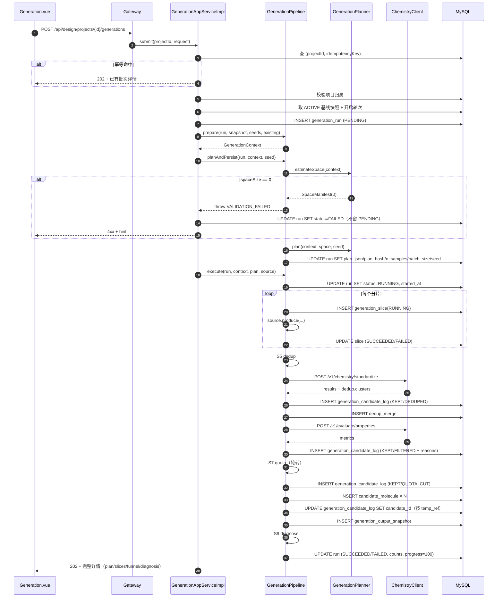
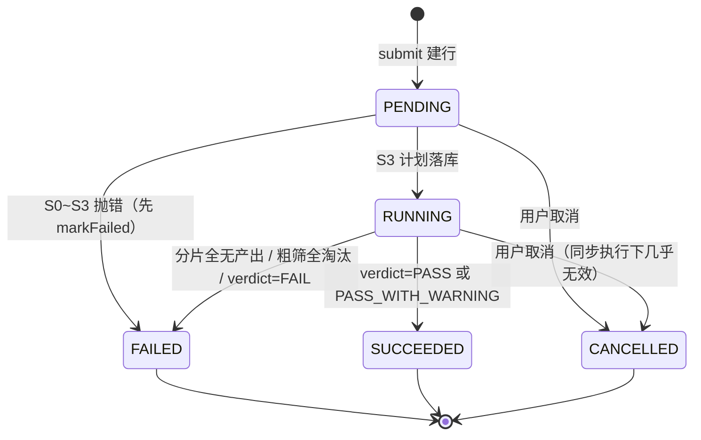
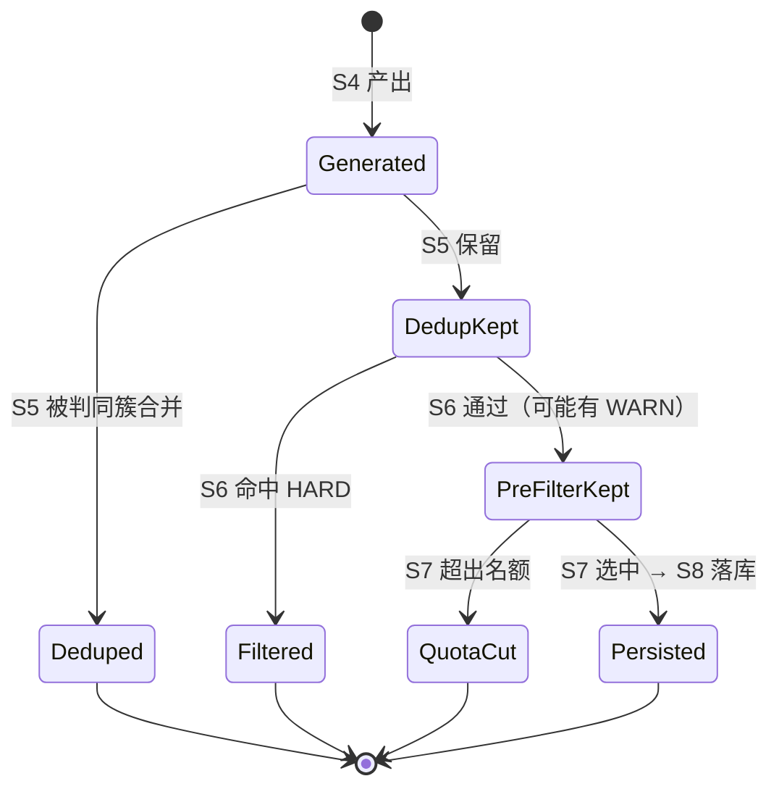

# 候选生成详细设计（S0~S9 实现级）

> **文档版本**：v2.0
> **日期**：2026-10-31
> **状态**：实现级说明书（以 `synpharm-core` 现有代码为准）
> **上游**：[主业务三阶段设计方案 §4](./06-主业务三阶段设计方案.md)、[数据层详细设计](./01-数据层详细设计.md)、[接口层详细设计](./02-接口层详细设计.md)
> **落地产物**：`sql/41_generation.sql`、`sql/43_edit_log_link.sql`、`com.synpharm.design.support.generation.*`
> **定位**：06 文档回答「生成阶段应该怎么做」，本文回答「代码现在到底怎么做、哪些还没做、判定依据是什么」。
> **v2.0 变更**：新增第二部分「实现规格附录」（§16~§27）——字段级数据字典、完整 DDL、计算层契约、判定矩阵穷举、去重与配额算法伪码及算例、时序与状态图、日志写入矩阵、错误码全表、前端状态映射、容量估算、变更影响面、测试用例明细。

---

## 目录

**第一部分：行为规格**

| 节 | 内容 |
|---|---|
| [1](#1-范围与阅读方式) | 范围、能力真实性矩阵 |
| [2](#2-数据模型) | 表与职责、关键列、`temp_ref`、轨迹语义 |
| [3](#3-状态机) | 批次 / 分片 / 候选三层状态 |
| [4](#4-请求契约) | 提交请求字段与语义 |
| [5](#5-流水线实现规格) | S0~S9 逐步闸门与产出 |
| [6](#6-约束判定规格核心) | 阈值来源、算子推导、边界语义、目录软硬 |
| [7](#7-幂等并发与错误归一化) | 幂等、唯一键 409 |
| [8](#8-接口清单) | 7 个端点 |
| [9](#9-前端交互设计) | 三段式导航与文案红线 |
| [10](#10-审计与可复现) | 5 个必答问题 + 回放缺口 |
| [11](#11-测试策略) | 已有用例与缺口 |
| [12](#12-缺陷与修复记录) | R-1~R-3 |
| [13](#13-已知限制不在本次修复范围) | 8 项限制 |
| [14](#14-与-06-文档的差异说明) | 与 06 的口径差异 |
| [15](#15-验收清单) | 验收勾选表 |

**第二部分：实现规格附录**

| 节 | 内容 |
|---|---|
| [16](#16-字段级数据字典) | 6 张表逐字段：类型/空/默认/写入方/语义 |
| [17](#17-完整-ddl) | 目标态 DDL + 索引与查询路径 |
| [18](#18-组件职责矩阵) | 分层、类、依赖方向 |
| [19](#19-计算层契约) | 两个端点的请求/响应与契约要点 |
| [20](#20-约束判定矩阵穷举) | 算子矩阵、结果矩阵、策略矩阵、实测对照 |
| [21](#21-去重算法规格s5) | 小分子 / 序列伪码、已知风险 |
| [22](#22-采样与配额算法含算例) | nSamples 分段、配额轮转算例、种子派生 |
| [23](#23-时序与状态图) | 提交流程时序、批次与分子状态图 |
| [24](#24-日志写入矩阵) | 各 stage×outcome 写入内容、JSON 形状、统计口径 |
| [25](#25-错误码全表) | 场景 → HTTP → code → 前端表现 |
| [26](#26-前端实现规格) | 组件树、状态映射、校验、轮询 |
| [27](#27-容量性能与影响面) | 成本估算、影响面、数据增长 |
| [28](#28-测试用例明细) | 断言清单、待补用例、E2E 脚本 |
| [29](#29-缺陷登记表) | 编号化缺陷清单与处置建议 |

---

## 1. 范围与阅读方式

- 覆盖：候选生成（`/api/design/generations`）的请求契约、S0~S9 流水线、约束判定、去重、配额、闸门、审计与回放。
- 不覆盖：需求基线冻结（见 06 §3）、评估与编辑（06 §5/E0~E7）、决策（07）。
- **能力真实性**是本系列的红线：文档中凡标注「未部署」「规则实现」「未启用」的，都是当前代码的真实状态，不得按已完成理解。

### 1.1 当前实现事实

| 项 | 设计（06） | 当前实现 | 影响 |
|---|---|---|---|
| S1 结构准备 | prep 工具 + pLDDT 判定 | **未实现**（跳过） | 不校验结构可修复性；`pocketAvailable` 只做标记 |
| S3 策略拟定 | Agent① 选策略 | **规则实现**（`GenerationPlanner`） | 策略由「空间类型」直接映射，不含推理 |
| S4 分片执行 | 调度器 + 队列 + 实时扣 GPUh | **同步执行**，`gpu_hours_used=0` | 请求内跑完，无异步轮询；超 30s 有超时风险 |
| S5 去重 | 计算层 ECFP4 聚类 | **已实现**（调用 `/v1/chemistry/standardize`） | 计算层不可用时抛异常，不降级 |
| S6 粗筛 | RDKit 指标 + 硬约束 | **已实现**（12 项指标） | 依赖计算层 `/v1/chemistry/properties` |
| S7 配额 | 多样性轮转 | **已实现** | 有效簇 < 3 只告警不拦截 |
| S8 快照 | 完整回放包 | **已实现** | 见 §10 回放缺口 |
| S9 漏斗解读 | Agent② 写文案 | **规则实现**（`FunnelDiagnosis`） | verdict 由代码判定，无 LLM |
| 缓存优先 | `generation_cache` 三元组 | 表已建，**未读写** | 规则式产出无可复用外部产物 |
| 生成引擎 | crem | **未部署** | 小分子只能「导入后筛选」 |

---

## 2. 数据模型

### 2.1 表与职责

| 表 | 粒度 | 写入时机 | 可变性 |
|---|---|---|---|
| `generation_run` | 一次生成（批次） | S0 建行 → S3 回填计划 → S4~S9 更新计数/状态 | 可更新，状态单向推进 |
| `generation_slice` | 一次生成的一个分片 | S4 每片插入并收尾 | 可更新（状态、产出数、耗时） |
| `generation_candidate_log` | **一个分子在一个 stage 的一条轨迹** | S5/S6/S7 逐分子写入 | **追加型，不改不改删** |
| `dedup_merge` | 一次合并关系 | S5 合并时 | 追加型 |
| `generation_output_snapshot` | 一次生成的完整回放包 | S8 | 追加型，`run_id` 唯一 |
| `generation_cache` | 三元组缓存条目 | 预留，当前不写 | — |
| `candidate_molecule` | 通过闸门后的正式候选 | S8 逐条插入 | 可更新（评估/编辑阶段） |

### 2.2 关键列与语义

`generation_run` 由 `41_generation.sql` 增加 14 列，其中决定行为的是：

| 列 | 语义 | 谁写 |
|---|---|---|
| `baseline_snapshot_id` | S0 只读的基线快照；**不回读**项目当前状态 | `planAndPersist` |
| `plan_json` / `plan_hash` | S3 的完整计划与摘要 | `planAndPersist` |
| `n_samples` | 采样数，由空间规模算出（§6） | 同上 |
| `batch_size` | 分片大小 | 同上 |
| `seed` | 全局种子；为空则随机并写回，用于复现 | 同上 |
| `estimated_gpu_hours` | 规则实现恒为 `0.000`（不虚报估值） | 同上 |
| `min_candidates` | 闸门阈值，**同时作为 S7 名额上限** | 同上 |
| `valid_cluster_count` | S7 有效簇数 | S7 后 |
| `output_snapshot_id` | S8 快照 id | S8 后 |
| `idempotency_key` | 幂等键；**不含项目维度的唯一性由应用层保证** | submit |

`candidate_molecule` 由 41/42 增加 `pipeline_status`、`cluster_id`、`pre_score`、`molecule_subtype`、`heavy_chain`、`light_chain`、`extra_chains`、`structure_model_method`、`structure_confidence`、`version_no`、`edit_round`、`branch_status`、`needs_re_eval`、`eval_profile_id`。

`generation_candidate_log.temp_ref` **不在 41 里**，由 `43_edit_log_link.sql` 补列。这是「日志 → 落库候选」的唯一关联键：S5~S7 时分子还没有 `candidate_molecule.id`，S8 落库后按 `temp_ref` 回填 `candidate_id`。

### 2.3 为什么日志表不能复用 `candidate_molecule`

`candidate_molecule` 上有 `uk_project_inchikey (project_id, inchikey)`。同一分子在批次 1 被筛掉、批次 2 再次提交时，第二行插不进去，也就无法记录「这次为什么又被筛」。日志按 `(run_id, 分子, stage)` 记录，不受该唯一键约束。

### 2.4 轨迹语义（前端必须知道）

同一分子会在多个 stage 各留一行，这是**阶段轨迹**而不是重复：

```
S5_DEDUP      KEPT|DEDUPED
S6_PRE_FILTER KEPT|FILTERED
S7_QUOTA      KEPT|QUOTA_CUT
```

因此「逐分子去向」页面必须按 `stage` 或 `outcome` 过滤后再做统计，否则会把同一分子算多次。

---

## 3. 状态机

### 3.1 批次（`generation_run.status`）

```text
                S0~S3 校验失败
                        ↓
PENDING ──► RUNNING ──► FAILED
   │           │  │
   │           │  └──► SUCCEEDED（含 PASS_WITH_WARNING）
   └───────────┴──────► CANCELLED（仅 PENDING/RUNNING 可取消）
```

- `PENDING`：`submit` 建行后立即置位，`strategies='PENDING'` 占位（该列 NOT NULL）。
- `S0~S3` 抛 `BizException` 时 **必须先 `markFailed` 再抛**，否则留下永远 PENDING 的行，配额无法释放、用户看到「提交成功但什么都没发生」。
- `S4` 之后失败：**不抛 500**，落 `FAILED` + `error_msg`，返回 202 + 详情（诊断信息比 500 有用）。
- 进度：`40`（S4 后）→ `55`（S5）→ `70`（S6）→ `85`（S7）→ `100`（S9）。

### 3.2 分片（`generation_slice.status`）

`PENDING → RUNNING → SUCCEEDED | FAILED`。单分片失败只累加 `failedSlices`，不中断其它分片；**全部分片无产出**才判整批失败。

### 3.3 候选（`candidate_molecule.pipeline_status`）

落库候选统一 `passed`、`review_status='NEW'`、`hard_passed=1`、`version_no=1`、`edit_round=0`、`branch_status='active'`、`needs_re_eval=0`。只有通过 S6 与 S7 的分子才会创建 `candidate_molecule` 行。

---

## 4. 请求契约

`POST /api/design/projects/{projectId}/generations` → **HTTP 202**

```json
{
  "baselineSnapshotId": null,
  "idempotencyKey": null,
  "seed": null,
  "seeds": [
    { "ref": "LIB-118", "libraryItemId": 118 },
    { "ref": "SEED-1", "smiles": "CC(=O)Oc1ccccc1C(=O)O" },
    { "ref": "SEED-2", "heavyChain": "EVQL...", "lightChain": "DIQM...", "extraChains": [] }
  ]
}
```

| 字段 | 约束 | 语义 |
|---|---|---|
| `baselineSnapshotId` | 可空 | 为空取项目当前 ACTIVE 快照；显式传入可重跑历史基线 |
| `idempotencyKey` | ≤64 | 同项目同键返回已有批次，不产生第二份候选集 |
| `seed` | 可空 | 为空则随机生成并写回 `run.seed` |
| `seeds` | 可空 | 为空则**退回项目内已有候选作为父本（最多 50 条）** |
| `seeds[].ref` | — | 日志追溯用 |
| `seeds[].libraryItemId` | — | **首选**：数据资产库条目 id，服务端按可见性解析结构（见 §4.1） |
| `seeds[].smiles` | — | 小分子（库里有现成的就不要再传这个） |
| `seeds[].heavyChain/lightChain/extraChains` | — | 序列类分子 |

**故意不加 `@NotEmpty`**：不传与传空数组都合法，语义是「用项目已有候选当父本」。真的两者皆空时由 S2 抛「搜索空间为空」，让用户看到可操作提示，而不是被参数校验拦在门外。

### 4.1 从库选种子（`libraryItemId`）

**为什么加这个字段**：SMILES 是结构，不是名字。没有生物信息背景的用户拿到「请填 SMILES」这一步就走不下去，
而库里已经存着分子名、分子量、适应症标签。让用户勾选，比让他拼化学式现实。

规则：

| 情况 | 行为 |
|---|---|
| 条目不存在 / 所属数据集不可见 | **404** `LIBRARY_ENTRY_NOT_FOUND`（不区分「不存在」与「不是你的」） |
| 条目是 `TARGET` | **400** `LIBRARY_ENTRY_NOT_SEEDABLE` —— 靶点不是候选分子，进 S4 只会产出空结构 |
| 条目是 `MOLECULE` | 取 `canonical_smiles`（没有才退回 `smiles`）作为种子 |
| 条目是 `SEQUENCE` | 取 `heavy_chain` / `light_chain` |
| 库里的名字 | 写入 `generation_params.seedName` → 落库 `candidate_molecule.molecule_name` |

**结构必须由服务端解析，不接受前端回传。** 前端回传等于把「这个条目属于你」的校验权交给调用方：
任何人拿到别人的 `libraryItemId` 就能把别人的私有分子塞进自己的批次。

—— 附带效果是候选带上了名字：版本树不再显示 `CCOc1ccc…` 这种截断 SMILES，而是「阿司匹林」。

### 4.2 跨批次去重（S5.5）

候选表按 `(project_id, inchikey)` / `(project_id, sequence_hash)` 唯一。上一版只在**批次内**去重，
于是「第二次用同一批种子再跑一次」会在 S8 插入时撞唯一键，整个提交返回 **409「该分子已存在」** ——
而「回 S2/S3 重跑补足」恰恰是我们自己写在诊断里的建议。用户回到候选生成页再提交一次，
看到的是一个报错，页面也没有批次可复盘，表现为「第二次来就走不下去了」。

现在在 S5 之后加一段跨批次去重：

| 情况 | 行为 |
|---|---|
| 与候选池里已有分子重复 | 记 `MERGED` 日志，`dedupInto` 指向已有候选 id，原因码 `DUPLICATE_OF_EXISTING` |
| 部分重复 | 只把新的送进 S6，`afterDedup` 如实反映 |
| 全部重复 | 返回一个 `status=FAILED` 的批次，`gate=ALL_DUPLICATE`，不让数据库抛异常 |

**「全部重复」不该被说成「筛不出候选」**：前者该做的是换种子，后者才该放宽约束。
两者的 `gate` 与建议动作是分开的。

### 4.3 失败也是结果：不再用 409 盖掉漏斗

同一个道理下把 S6 粗筛剩 0 也改成返回 `status=FAILED` 的批次（之前抛 `BUSINESS_CONFLICT`）。
抛异常会让「逐分子去向」里的每一条淘汰原因一起消失 —— 而那正是用户排查的唯一线索。
现在两条失败路径都会写 `generation_output_snapshot`，漏斗与诊断读得回来。

### 4.4 `gate` 字段：能进入 ≠ 达标

`verdict` 回答「能不能往下走」，`gate` 回答「为什么」：

| gate | verdict | readyForEdit | 界面措辞 |
|---|---|---|---|
| `OK` | PASS | true | 通过 · 可进入编辑 |
| `BELOW_MIN_CANDIDATES` | PASS_WITH_WARNING | true | **未达标 · 候选数不足** |
| `BELOW_DIVERSITY` | PASS_WITH_WARNING | true | **未达标 · 多样性不足** |
| `EMPTY` | FAIL | false | 未通过 · 无候选 |
| `ALL_DUPLICATE` | FAIL | false | 未通过 · 无新增候选 |

候选数不足仍然允许进入编辑（否则用户会被卡死），但结论不能写成绿色的「通过」——
一个页面不能同时说「通过」和「覆盖不足」。

顺带修掉的归因错误：候选只有 2 个时簇数必然也小于 3，于是「有效簇数仅 2（少于 3）」
这条告警会把「数量不足」说成「多样性不足」。现在只在**候选数够、却挤在少数簇里**时才报多样性。

---


## 5. 流水线实现规格

### 5.1 S0 基线校验与任务登记

**输入**：`GenerationRun`、`BaselineSnapshot`、显式 seeds、项目已有候选。

**闸门（任一不满足即抛 `BASELINE_INCOMPLETE` / `VALIDATION_FAILED`）**：

1. `completeness_json` 中不存在任何 `MISSING` 块；报错要列出缺失块名。
2. `quota_json.minCandidates` 存在且 ≥ 1（否则后置闸门无从判定）。
3. `hard_rules_json` 解析出的规则**非空**（没有硬约束的生成等于没有闸门）。
4. 种子：显式 seeds 优先；否则取项目已有候选（上限 50）。

**产出** `GenerationContext`：`projectId`、`baselineSnapshotId`、`modalityCode`、`seqRequired`、`moaCode`、`minCandidates`、`quotaGpuHours`、`quotaWetLab`、`hardRules`、`seeds`、`pocketAvailable`。

- `seqRequired`：形式属于 `ANTIBODY / BISPECIFIC / NANOBODY / PEPTIDE / FUSION_PROTEIN / ADC`。
- `pocketAvailable`：`structure_json.pockets[]` 中存在 `isSelected=true`。**当前只记录不消费**——规则式不做对接。

### 5.2 S1 结构准备

**未实现**。不做结构修复、不做 pLDDT 阈值判定。文档与 UI 均不得声称「S1 已通过」。

### 5.3 S2 搜索空间定义

`GenerationPlanner.estimateSpace` 按输入形态返回 `SpaceManifest(sourceType, spaceSize, seedCount, description, exclusions)`：

| 条件 | sourceType | spaceSize | exclusions 关键项 |
|---|---|---|---|
| 无种子且无引擎 | `NONE` | 0 → **必失败** | `NO_SEED_AND_NO_GENERATOR` |
| 需序列且无合法序列种子 | `SEQUENCE_MUTATION` | 0 → 必失败 | 逐个说明哪个种子不是序列 |
| 需序列且有序列种子 | `SEQUENCE_MUTATION` | `Σ(序列长度 × 19)` | 不含多点突变与 CDR 定向设计 |
| 小分子有 SMILES | `SEED_LIBRARY` | SMILES 种子数 | 「结构编辑端点未实现，本轮不做结构创新」 |
| 小分子无 SMILES | `SEED_LIBRARY` | 0 → 必失败 | 逐个说明缺 SMILES |

`spaceSize <= 0` 抛 `VALIDATION_FAILED`，`data` 携带 `sourceType`、`exclusions`、`hint`。

### 5.4 S3 生成计划

```text
target   = max(1, minCandidates)
wanted   = target × 3                     // SAMPLE_MULTIPLIER
nSamples = min(min(wanted, spaceSize), 3000)      // MAX_SAMPLES
nSamples = max(nSamples, min(target, min(spaceSize, 3000)))   // 至少够目标数
batchSize = min(100, max(1, nSamples))    // DEFAULT_BATCH_SIZE
```

- `degraded = spaceType != 'ENGINE'`；`degradedReason` 按形态给出人话（例如「用户提供的候选直接进入筛选，未做结构创新」）。
- `estimatedGpuHours = 0.000`（**如实记 0，不给好看的估值**）。
- 计划落到 `run.plan_json` 与 `plan_hash`，`strategies` 由 `PENDING` 改为实际类型。

### 5.5 S4 分片执行

- 片数 `sliceCount = ceil(nSamples / batchSize)`，至少 1 片。
- 每片插入 `generation_slice`：`param_hash = sha256(plan_json)`、`input_hash = sha256(baselineSnapshotId)`、`seed = plan.seed × 1_000_003 + sliceNo`（同种子可复现，不同片互不相同）。
- `CandidateSource` 按 `sourceType` 由 Spring 注入的 Map 选择；找不到实现抛 `VALIDATION_FAILED` 并回传 `available` 列表。
- 单片异常 → 该片 `FAILED` + `error_msg`（截断 900 字符）；继续下一片。
- 汇总产出为 0 → 整批 `FAILED`，`error_msg` 区分「全部分片失败」与「分片未产出候选（种子空间不足）」。

### 5.6 S5 去重

两条完全不同的路径，混用会出错：

| 类型 | 方法 | 去重键 | 阈值 |
|---|---|---|---|
| 小分子 | 计算层 `/v1/chemistry/standardize` 规范化 + ECFP4 Tanimoto 聚类 | 规范化 InChIKey | **0.90**（`DEFAULT_THRESHOLD`） |
| 序列 | 字符串精确 | `sequence_hash` | 精确相等 |

- 必须先规范化再比：`CC(=O)Oc1ccccc1C(=O)O` 与 `OC(=O)c1ccccc1OC(C)=O` 是同一分子，字符串比对会当成两个。
- 序列**不做相似度合并**：只差一个残基的两条抗体是两个真实不同的分子。
- **S5 不会失败**（纯确定性运算），但计算层不可用时**抛异常而不是跳过去重**——跳过去重会让重复分子占满名额且用户看不出来。
- 每个分子写日志：保留者 `KEPT`，被合并者 `DEDUPED`，原因码 `DEDUP_MERGED` 并记录相似度与合并目标 `tempRef`；同时写 `dedup_merge`（`method` 为 `ECFP4` 或 `EXACT`）。

### 5.7 S6 粗筛

一次批量调用计算层 `/v1/chemistry/properties`，指标固定 12 项：

```
MOL_WT, MOL_LOGP, TPSA, NUM_H_DONORS, NUM_H_ACCEPTORS, NUM_ROTATABLE,
QED, LIPINSKI_PASS, PAINS_HITS, BRENK_HITS, COMPLEXITY_PENALTY, NUM_RINGS
```

**三条纪律**：

1. **原因必记**：被筛掉的分子都带机器码 + 中文说明。
2. **判不了必须说判不了**：`SMARTS_REQUIRED`、`SIMILARITY_RANGE` 等计算层不具备的能力记为 `SKIPPED_*`，在诊断里单列，**绝不当作通过**。
3. **不返回 0 值填充**：指标算不出时该分子记 `ILLEGAL_RESIDUE`（结构无法解析），不用 0 冒充——0 的 LogP 和算不出的 LogP 在决策阶段含义完全不同。

判定顺序：`applyHardRules` → `applySafetyCatalog`。`preScore`（0~100，可空）由四项可解释加权：

```
0.40×QED + 0.30×(1 − min(complexity,3)/3) + 0.20×min(Lipinski,4)/4 + 0.10×(1 − min(PAINS+BRENK,3)/3)
```

`QED` 或 `complexity` 缺失 → `preScore = null`（不是 0）。

### 5.8 S7 多样性配额

- **名额 = `minCandidates`**（`quota = context.minCandidates()`）。
- 按簇分组（簇为空时用 `CL-<tempRef>` 兜底）→ 簇内按 `preScore` 降序、同分按 `tempRef` 去重 → **轮转填充**：每轮每簇取 1 个，直到名额用完。
- 轮转而非固定配额的效果：簇少的池子自然把名额让给簇多的，无需额外调参。
- 有效簇 < `MIN_VALID_CLUSTERS = 3` → 告警但**放行**（覆盖不足是策略问题，不是数据错误；硬拦会让用户连「看看多差」都做不到）。
- 被裁掉的写 `QUOTA_CUT`，原因含「超出名额 N（该簇排名 i）」。

### 5.9 S8 登记与快照

- 逐个 `insert candidate_molecule`（字段见 §3.3），拿到 id 后**按 `temp_ref` 回填** `generation_candidate_log.candidate_id`。不回填则「逐分子去向」点不到候选。
- 写 `generation_output_snapshot`：`candidate_ids`、`filter_summary`（四段漏斗）、`cluster_dist`、`plan_json`、`tool_versions`、`content_hash`（对 `run_id + 候选 id 列表` 做 sha256，不含时间，保证同输入同摘要）。

### 5.10 S9 漏斗解读

`FunnelDiagnosis.diagnose(funnel, minCandidates, validClusters, warnings)`：

| 条件 | verdict | readyForEdit | 建议 |
|---|---|---|---|
| `finalCount == 0` | `FAIL` | false | 回 S2 查空间/种子，或回 S3 换策略（最多 2 轮） |
| `finalCount < minCandidates` | `PASS_WITH_WARNING` | true | 允许进编辑但建议补足 |
| 否则 | `PASS` | true | 可进入编辑 |

- **verdict 由代码判定，LLM 只写文案**：若让模型决定 PASS/FAIL，它就能把失败说成成功，而「能否进下一步」必须有唯一答案。
- `SKIPPED_*` 规则会以「以下规则未能判定（不是通过）：…」写入 `run.error_msg`，并在诊断里呈现。
- 只有 `FAIL` 会把 `run.status` 置 `FAILED`；`PASS_WITH_WARNING` 是 `SUCCEEDED`。

---

## 6. 约束判定规格（核心）

### 6.1 规则的两种来源

S6 只处理 `ruleType == NUMERIC_RANGE`；`FILTER_CATALOG` 交给安全性目录判定；其余类型（SMARTS/骨架/相似度等）一律 `SKIPPED_<TYPE>`。

**阈值取值优先级**：`params.min` / `params.max` 优先，缺失时回退 `thresholdNum` / `thresholdMax`。

**算子推导**（基线只给 min/max，不给 operator）：

| params | 推导 operator |
|---|---|
| min 与 max 都有 | `BETWEEN` |
| 只有 min | `GTE` |
| 只有 max | `LTE` |
| 都没有 | `SKIPPED_NO_THRESHOLD` |

**字段映射**：`params.field` → 计算层指标码，由 `MetricFieldMapper` 统一维护（`MolWt`→`MOL_WT`、`LogP`→`MOL_LOGP`、`HBD`→`NUM_H_DONORS` 等）。映射不上 → `SKIPPED_UNMAPPED_FIELD:<field>`；指标缺失 → `SKIPPED_NO_METRIC:<code>`。**不猜、不用近似值顶替。**

### 6.2 边界判定语义

`BoundaryJudge.judge(actual, operator, thresholdNum, thresholdMax, tolerance, policy)`：

1. **等号归属由算子决定**：`LTE 100` 的 100 达标，`LT 100` 的 100 不达标。
2. **只有上限时必须认 `thresholdMax`**：`LTE/LT` 且 `thresholdNum` 为空时，把 `thresholdMax` 作为阈值。基线 `{max:140, field:TPSA}` 走的就是这条路（见 §12 修复记录 R-1）。
3. **容差只向外扩**：下限型放宽到 `threshold − tol`，上限型放宽到 `threshold + tol`，区间型两端外扩。`STRICT` 下即使配了容差也不放宽。
4. **无实测值 = FAIL**，不参与容差；**无阈值 = FAIL**，不静默通过。
5. 策略：`STRICT` 越界即淘汰；`WITHIN_TOLERANCE` 容差内达标但打 `BOUNDARY_WARNING`；`ESCALATE_TO_SOFT` 不判硬性达标，转软约束扣分。

### 6.3 安全性目录（PAINS / BRENK）

- 只有基线显式声明 `ruleType=FILTER_CATALOG` 且 `params.mode=must_pass` 时，命中才记为 `HARD`（淘汰）。
- 否则记为 `WARN`（保留但扣分/告警）。
- 这是为了尊重基线的软硬划分：`PAINS` 配 hard、`BRENK` 配 soft 时，两者不能被一视同仁地硬淘汰（见 §12 修复记录 R-2）。

### 6.4 判定结果到日志

| verdict | 日志 code | severity | 是否淘汰 |
|---|---|---|---|
| `FAIL` | `HARD_CONSTRAINT_VIOLATION` | HARD | 是 |
| `ESCALATE` | `HARD_CONSTRAINT_ESCALATED` | WARN | 否 |
| `PASS_WITH_WARNING` | `BOUNDARY_WARNING` | WARN | 否 |
| `PASS` | 不记录（避免噪音） | — | 否 |
| 无法解析结构 | `ILLEGAL_RESIDUE` | HARD | 是 |
| PAINS/BRENK 命中 | `PAINS_HIT` / `BRENK_HIT` | 见 §6.3 | 见 §6.3 |

`isPassed()` 的判据只有一个：**不存在 severity=HARD 的理由**。

---

## 7. 幂等、并发与错误归一化

### 7.1 幂等

- 若请求带 `idempotencyKey`：先按 `(projectId, idempotencyKey)` 查已有批次，命中直接返回 `detail`，状态码仍是 202。
- 键为空表示「不做幂等」，允许重复提交；幂等只在**声明了同一意图**时才被要求。

### 7.2 唯一键冲突

`candidate_molecule.uk_project_inchikey` 冲突（同一项目重复分子）由 `GlobalExceptionHandler` 归一化：

| 触发键 | HTTP | errorCode |
|---|---|---|
| `uk_project_inchikey` / `uk_project_sequence` | 409 | `CANDIDATE_DUPLICATED`（40949，「该分子已存在」） |
| 其它唯一键 | 409 | `BUSINESS_CONFLICT`（40901） |

修复前该冲突会冒成 500「服务内部错误」（见 §12 修复记录 R-3）。

### 7.3 并发

当前为同步执行，同一项目并发提交多个批次会各自插入 `candidate_molecule`，由唯一键兜底；后到者得到 409 而不是脏数据。**没有分布式锁**，也不打算在规则式实现阶段引入。

---

## 8. 接口清单

| 方法 | 路径 | 说明 | 关键错误码 |
|---|---|---|---|
| POST | `/api/design/projects/{projectId}/generations` | 提交生成，同步跑完 S0~S9，返回 **202** | 40440 / 40455 / 40960 / 40000 / 40949 |
| GET | `/api/design/generations?projectId=&page=&pageSize=` | 批次列表（新→旧） | 40440 / 40100 |
| GET | `/api/design/generations/{id}` | 详情：plan / 分片 / 漏斗 / 诊断 | 40000 / 40100 |
| GET | `/api/design/generations/{id}/funnel` | 四段转化率 + 淘汰原因 Top5 | 40000 |
| GET | `/api/design/generations/{id}/diagnosis` | S9 诊断（verdict + findings） | 40000 |
| GET | `/api/design/generations/{id}/candidates?stage=&outcome=` | 逐分子轨迹（**上限 500 行**） | 40000 / 40100 |
| POST | `/api/design/generations/{id}:cancel` | 仅 `PENDING`/`RUNNING` 可取消 | 40901 |

**归属校验**：所有端点先 `loadOwned`，项目或批次不属于当前用户一律 404（不返回 403，避免探测存在性）。

**分页**：`candidateLogs` 固定 `LIMIT 500` 且无分页参数——批次分子数超过 500 时轨迹会被截断，这是已知限制（见 §13）。

---

## 9. 前端交互设计

页面：[Generation.vue](../../../../synpharm-frontend/src/views/Generation.vue)，子组件 `GenerationConfig`、`GenerationFunnel`、`GenerationDiagnosis`、`GenerationCandidates`。

### 9.1 三段式导航

`发起生成` / `批次列表` / `批次详情`。顶部状态条只认后端事实：

| 后端状态 | 顶部文案 |
|---|---|
| 无冻结基线 | `缺基线`：请在需求分析里冻结 |
| 基线冻结 + 有轮次 | `可生成` |
| 批次 `FAILED` 且无剩余候选 | 失败横幅 + 主要淘汰原因 |
| 批次 `SUCCEEDED` | 候选数与 verdict |

### 9.2 发起表单

| 控件 | 行为 |
|---|---|
| 来源形态 | 当前只有「小分子（SMILES，导入筛选）」与序列；选择决定「一行一个 SMILES」还是重/轻链输入 |
| 全局种子 | 可空，空则随机；提交后展示在详情里供复现 |
| 幂等键 | 可空；填写后同键重复提交返回同一批次 |
| SMILES 文本域 | 按行切分、去空行；底部实时显示「N 个 SMILES」；N=0 时提交按钮禁用 |
| 提交生成 | 成功后切到详情；409 时显示后端 message |

**文案红线**：必须显式说明「当前没有部署生成引擎，小分子只能导入后筛选，批次会标 degraded」，避免用户误以为 AI 在造分子。

### 9.3 详情页

- **计划折叠区**：展示 `nSamples`、`batchSize`、`seed`、`plan_hash`、`degraded` 与理由。
- **分片折叠区**：每片状态、产出数、错误。
- **筛选漏斗**：生成 → 去重 → 粗筛 → 配额 四段，附转化率；有效簇不足时标注「覆盖不足」。
- **主要淘汰原因**：原因码照抄后端，不做美化（排查时能对着日志搜到）。
- **逐分子去向**：阶段/结局/分子/簇/预筛分/原因；支持按 stage 与 outcome 过滤。

---

## 10. 审计与可复现

一份可复现的生成批次必须能回答五个问题：

| 问题 | 依据字段 |
|---|---|
| 用的哪份基线 | `run.baseline_snapshot_id` |
| 用什么策略、采多少、什么种子 | `run.plan_json` / `n_samples` / `batch_size` / `seed` |
| 计划有没有被篡改 | `run.plan_hash` |
| 每个分子为什么留/走 | `generation_candidate_log`（逐 stage） |
| 最终候选集是什么 | `generation_output_snapshot.candidate_ids` + `content_hash` |

### 10.1 当前回放缺口（必须如实记录）

1. `generation_candidate_log.inchikey` **恒为 null**：`writeLog` 里 `setInchikey(null)`，`idx_inchikey` 形同虚设，无法按结构反查「这个分子历史上被筛过几次」。
2. `dedup_merge.representative_id` / `merged_id` **未写入**（S5 时候选尚未落库，只有 `merged_log_id`），合并关系需经 `temp_ref → candidate_id` 二次解析。
3. `generation_cache` 已建表但**无读写路径**，重跑同参数不会命中缓存。
4. S1 未实现，快照里没有结构准备结论，因此「同样的结构能否复现出同样的口袋」目前无法回答。

---

## 11. 测试策略

### 11.1 已有用例

| 测试类 | 覆盖点 |
|---|---|
| `BoundaryJudgeTest`（19） | 等号归属、容差方向、**只有上限的判定**、策略分支 |
| `PreFilterStageTest`（5） | 字段映射、未映射返回 null、**FILTER_CATALOG must_pass**、只有 HARD 才淘汰 |
| `GenerationPlannerTest`（8） | 空间估算、采样上限、degraded 标注 |
| `DiversityQuotaStageTest`（6） | 轮转填充、簇不足告警、配额裁剪 |
| `FunnelDiagnosisTest`（7） | 三种 verdict 与 readyForEdit |
| `HardRuleParserTest`（5） | 二次编码 paramsJson 的两种形态 |
| `GlobalExceptionHandlerTest`（含新增） | 唯一键冲突归一化为 409 |

整体：`mvn -o -pl synpharm-core test` → **444 项通过**（2026-10-31）。

### 11.2 尚缺的用例

- `GenerationPipeline` 端到端（mock `CandidateSource` + 计算层）覆盖 S4 全失败、S6 全淘汰两条失败路径。
- `writeLog` 的 `temp_ref` 回填断言（当前只能靠人工看页面）。
- 幂等键并发提交（同键两次并发请求）。

---

## 12. 缺陷与修复记录

| # | 现象 | 根因 | 修复 | 影响面 |
|---|---|---|---|---|
| R-1 | 任何分子都被判「违反硬约束」，批次永远「粗筛后无剩余候选」；提示形如 `TPSA：越界（实测 63.6 ≤ —，超出 0）` | 基线 `params` 只有 `max` 时，S6 把它传进 `thresholdMax`，而 `BoundaryJudge` 的 `LTE` 只读 `thresholdNum`，于是阈值取到 null，`actual.compareTo(null)` 路径直接判 FAIL | `LTE/LT` 且 `thresholdNum` 为空时，将 `thresholdMax` 作为阈值；`describe` 同步展示正确上限 | 粗筛、评估、决策共用该方法 |
| R-2 | 软约束 BRENK 命中被当作硬淘汰 | `applySafetyCatalog` 无条件 `severity=HARD`，未读基线规则 | 新增 `mustPass(rules, catalog)`：仅 `FILTER_CATALOG + mode=must_pass` 记 HARD，否则 WARN | 尊重基线软硬划分 |
| R-3 | 重复提交同一分子返回 500「服务内部错误」 | 数据库 1062 未被归一化，落入兜底 `Exception` 分支 | `GlobalExceptionHandler` 新增 `DuplicateKeyException` 处理：候选唯一键 → 409 `CANDIDATE_DUPLICATED`，其它 → 409 `BUSINESS_CONFLICT` | 生成、编辑、库、靶点绑定等所有写路径 |

验证：修复后同一批 6 个 SMILES 得到「去重 5 → 粗筛 2」，淘汰原因与基线一致（咖啡因 LogP −1.03 低于 −0.4、硬脂酸 LogP 6.33 且可旋转键 16、`C1CC` 无法解析）；再以 3 个合规分子取得 `PASS`、`readyForEdit=true`。

---

## 13. 已知限制（不在本次修复范围）

| 限制 | 后果 | 建议 |
|---|---|---|
| 同步执行、无异步任务 | 采样数大时可能触碰网关超时；`cancel` 对已跑完的批次无效 | 接真引擎时把 S4 移入线程池，状态机已就位 |
| 无生成引擎（crem） | 小分子只能导入筛选，批次恒 `degraded` | 部署引擎后新增 `ENGINE` 来源实现 |
| 无结构编辑端点 | 不能做定向衍生 | 实现 `/v1/molecules/edit` |
| S1 未实现 | 结构可修复性与 pLDDT 不参与闸门 | 补齐 S1 与 `degraded` 判定 |
| `candidateLogs` 硬上限 500 | 大批次轨迹被截断 | 增加分页参数并保留 `stage/outcome` 过滤 |
| `inchikey` 未落日志 | 无法按结构反查历史淘汰 | `writeLog` 传入去重阶段的 `inchikey` |
| 缓存未启用 | 重跑不省算力 | 引擎接入后按三元组写入/命中 |
| 软约束不参与淘汰但也不扣分 | 软约束目前只产出 `WARN` 日志，未进入 `preScore` 权重调整 | 在 `computePreScore` 中引入软约束惩罚项，或在评估阶段处理 |

---

## 14. 与 06 文档的差异说明

| 项 | 06 写法 | 本文修正/补充 |
|---|---|---|
| S7 名额 | 「来自基线块7 与决策档位无关」 | 明确 `quota = minCandidates`，无其它上限 |
| S8 `content_hash` | 未定义输入 | 明确为 `run_id + 候选 id 列表`，不含时间 |
| S9 判定方 | 「verdict 由代码算」 | 补充三种 verdict 的完整条件表与 `readyForEdit` |
| 硬约束阈值 | 只写 `thresholdNum/Max` | 补充 `params.min/max` 优先，以及只有上限时回退 `thresholdMax` |
| 日志表 | 未含 `temp_ref` | 明确该列由 `43_edit_log_link.sql` 补充，并说明回填机制 |

---

## 15. 验收清单

- [x] 无冻结基线时提交返回 4xx，且不留下 PENDING 批次。
- [x] 无种子且无引擎时返回「搜索空间为空」，并给出可操作 hint。
- [x] 同 `idempotencyKey` 重复提交返回同一批次。
- [x] 每个被淘汰分子都有 `generation_candidate_log` 行与原因码。
- [x] 只有上限的硬约束按上限判定，且提示不出现 `≤ —`。
- [x] 软约束目录命中不淘汰候选。
- [x] 重复分子返回 409「该分子已存在」，不是 500。
- [x] `PASS_WITH_WARNING` 时 `readyForEdit=true` 且写明「候选数低于闸门」。
- [x] `SKIPPED_*` 规则出现在诊断中，不被当作通过。
- [ ] 批次超过 500 个分子时轨迹可分页（未实现）。
- [ ] 重跑同参数命中缓存（未实现）。

---

# 第二部分：实现规格附录

> 以下章节给出可以直接照着写代码/建表/写测试的粒度。凡与代码不一致时，**以代码为准并回改本文**。

## 16. 字段级数据字典

### 16.1 `generation_run`（批次）

原表见 `19_generation_run.sql`，`41_generation.sql` 增补 14 列。

| 列 | 类型 | 空 | 默认 | 写入方 | 语义与约束 |
|---|---|---|---|---|---|
| `id` | BIGINT PK AI | 否 | — | — | — |
| `run_no` | VARCHAR(64) | 否 | — | submit | `G + yyMMddHHmmss + 4位随机`，`uk_run_no` |
| `project_id` | BIGINT | 否 | — | submit | FK `design_project` |
| `round_id` | BIGINT | 否 | — | submit | FK `design_round`；无开启轮次则提交失败 |
| `user_id` | BIGINT | 否 | — | submit | 归属校验依据 |
| `constraint_set_id` | BIGINT | 是 | NULL | — | 历史遗留，生成不读它（读快照） |
| `constraint_snapshot` | JSON | 是 | NULL | — | 历史遗留 |
| `strategies` | VARCHAR(500) | 否 | — | 建行时 `PENDING`，S3 覆盖 | 实际为单一来源类型（`SEED_LIBRARY`/`SEQUENCE_MUTATION`），**不是逗号列表** |
| `strategy_params` | JSON | 是 | NULL | — | 未使用（参数在 `plan_json`） |
| `seed_json` | JSON | 是 | NULL | — | 未使用 |
| `pocket_id` | BIGINT | 是 | NULL | — | 未使用；口袋信息来自快照 |
| `target_count` | INT | 否 | 100 | 建行置 0 | 历史字段，闸门看 `min_candidates` |
| `generated_count` | INT | 否 | 0 | S4 | S4 原始产出数 |
| `deduped_count` | INT | 否 | 0 | S5 | **去重后保留数**（不是被合并数） |
| `rejected_count` | INT | 否 | 0 | S6 | 硬约束淘汰数 |
| `final_count` | INT | 否 | 0 | S8 | 最终落库候选数 |
| `status` | VARCHAR(20) | 否 | PENDING | 状态机 | 实际只用 `PENDING/RUNNING/SUCCEEDED/FAILED/CANCELLED`；注释里的 `PARTIAL` **未使用** |
| `progress` | DECIMAL(5,2) | 否 | 0.00 | 各阶段 | 0 / 40 / 55 / 70 / 85 / 100 |
| `error_msg` | VARCHAR(1000) | 是 | NULL | 失败或警告 | 失败原因；**`PASS_WITH_WARNING` 或存在 SKIPPED 规则时也写这里**（承载警告文案） |
| `latency_ms` | INT | 是 | NULL | S9 | `completed_at − started_at` |
| `started_at` / `completed_at` | DATETIME | 是 | NULL | S4 / 终态 | — |
| `deleted` | TINYINT | 否 | 0 | — | 逻辑删除 |
| **`baseline_snapshot_id`** | BIGINT | 是 | NULL | S3 | 只读快照；S0 校验后回填 |
| **`plan_json`** | JSON | 是 | NULL | S3 | `GenerationPlan.toMap()` |
| **`plan_hash`** | CHAR(64) | 是 | NULL | S3 | `sha256(plan_json)` |
| **`fallback_strategy`** | VARCHAR(60) | 是 | NULL | S3 | 当前恒为 `SEED_LIBRARY` |
| **`n_samples`** | INT | 是 | NULL | S3 | 采样总量（§22） |
| **`batch_size`** | INT | 是 | NULL | S3 | 分片大小 |
| **`seed`** | BIGINT | 是 | NULL | S3 | 全局种子 |
| **`estimated_gpu_hours`** | DECIMAL(10,3) | 是 | NULL | S3 | 规则实现恒 `0.000` |
| **`rationale`** | TEXT | 是 | NULL | S3 | 选策略理由（人话） |
| **`plan_confidence`** | DECIMAL(5,4) | 是 | NULL | S3 | 规则实现给固定值（非模型置信度） |
| **`output_snapshot_id`** | BIGINT | 是 | NULL | S8 | 指向 `generation_output_snapshot` |
| **`valid_cluster_count`** | INT | 是 | NULL | S7 | 有效簇数 |
| **`min_candidates`** | INT | 是 | NULL | S3 | 闸门阈值，同时是 S7 名额 |
| **`idempotency_key`** | VARCHAR(64) | 是 | NULL | submit | 应用层唯一性：同项目同键复用 |

> **警告**：`error_msg` 一列承担两种语义（失败原因 / 警告说明）。前端不得用 `error_msg != null` 判定失败，必须看 `status`。

### 16.2 `generation_slice`（分片）

| 列 | 类型 | 空 | 写入方 | 语义 |
|---|---|---|---|---|
| `run_id` | BIGINT | 否 | S4 | FK `generation_run` |
| `job_id` | BIGINT | 是 | — | 预留 `design_job`；当前恒 NULL |
| `slice_no` | INT | 否 | S4 | 从 1 开始，`uk_run_slice(run_id, slice_no)` |
| `seed` | BIGINT | 是 | S4 | `plan.seed × 1_000_003 + slice_no` |
| `param_hash` | CHAR(64) | 否 | S4 | `sha256(plan_json)`（同批次各片相同） |
| `input_hash` | CHAR(64) | 否 | S4 | `sha256(基线快照 id 的十进制字符串)` |
| `tool_id` / `tool_version` | BIGINT / VARCHAR(20) | 是 | — | 预留；当前 NULL（未接引擎） |
| `status` | VARCHAR(20) | 否 | S4 | `RUNNING` → `SUCCEEDED`/`FAILED`；`PENDING`/`CANCELLED` 未使用 |
| `retry_count` | INT | 否 | — | 恒 0（未实现重试） |
| `produced_count` | INT | 否 | S4 | 本片实际产出 |
| `gpu_hours_used` | DECIMAL(10,3) | 否 | S4 | 恒 0 |
| `cache_hit` | TINYINT | 否 | — | 恒 0（缓存未启用） |
| `artifact_uri` | VARCHAR(800) | 是 | — | 恒 NULL |
| `error_msg` | VARCHAR(1000) | 是 | S4 | 异常消息截断 900 字符 |

### 16.3 `generation_candidate_log`（逐分子轨迹）

| 列 | 类型 | 空 | 写入方 | 语义 |
|---|---|---|---|---|
| `run_id` | BIGINT | 否 | S5~S7 | FK `generation_run` |
| `slice_id` | BIGINT | 是 | — | **恒 NULL**（流水线未把 slice 传进日志） |
| `stage` | VARCHAR(20) | 否 | S5~S7 | `S5_DEDUP` / `S6_PRE_FILTER` / `S7_QUOTA` |
| `temp_ref` | VARCHAR(64) | 是 | S5~S7 | 由 `43_edit_log_link.sql` 补列；S8 回填依据 |
| `smiles` | VARCHAR(2000) | 是 | S5~S7 | 原样（截断 1900）；序列类为 NULL |
| `sequence_hash` | CHAR(64) | 是 | S5~S7 | 序列类分子 |
| `inchikey` | CHAR(27) | 是 | — | **恒 NULL**（缺陷 D-1） |
| `candidate_id` | BIGINT | 是 | S8 回填 | 只有最终落库者才有 |
| `outcome` | VARCHAR(20) | 否 | S5~S7 | `KEPT` / `FILTERED` / `DEDUPED` / `QUOTA_CUT` |
| `filter_reason` | JSON | 是 | S5~S7 | `[{"code","severity","message"}]`；**注意字段名是 `message` 不是 `detail`** |
| `pre_score` | DECIMAL(7,3) | 是 | S6/S7 | 0~100，可空（指标缺失时） |
| `dedup_into` | BIGINT | 是 | — | **恒 NULL**（合并目标写在 `filter_reason.message` 里） |
| `cluster_id` | VARCHAR(40) | 是 | S5~S7 | `CL-<tempRef>` / `SCAF-<hex>` / `SEQ-<hash前12>` |
| `created_at` | DATETIME | 否 | — | 追加时间 |

### 16.4 `dedup_merge`（合并关系）

| 列 | 写入情况 | 说明 |
|---|---|---|
| `run_id` | ✅ | — |
| `merged_log_id` | ✅ | 指向被合并者的日志行 |
| `merged_id` | ❌ NULL | 被合并者未落库，无 candidate id |
| `representative_id` | ❌ NULL | 代表者也未必落库（可能被 S6 筛掉） |
| `similarity` | ✅ | 来自聚类 `maxSimilarity`；InChIKey 兜底时固定 1.0000 |
| `method` | ✅ | `ECFP4`（小分子）或 `EXACT`（序列/无 SMILES） |

> 结论：`dedup_merge` 当前只能回答「哪条日志被合并了、相似多少」，**不能直接 join 到候选**。要还原需 `merged_log_id → temp_ref → 候选`。

### 16.5 `generation_output_snapshot`（回放包）

| 列 | 内容 |
|---|---|
| `snapshot_no` | `SerialNumbers` 生成，`uk_gos_no` |
| `run_id` | `uk_gos_run`（一批次一份） |
| `candidate_ids` | JSON 数组，顺序同 S8 落库顺序 |
| `filter_summary` | `Funnel.toMap()`（§19） |
| `cluster_dist` | `{clusterId: 选中数量}` |
| `plan_json` | S3 计划副本 |
| `tool_versions` | 当前为规则实现的版本标注 |
| `content_hash` | `sha256(run_id + candidate_ids)`，**不含时间**，故同输入同摘要 |

### 16.6 `candidate_molecule`（S8 落库字段）

| 字段 | 值 | 说明 |
|---|---|---|
| `project_id` / `round_id` / `origin_run_id` | 来自 run | 归属链 |
| `smiles` / `canonical_smiles` | 截断 1900 | 原始与规范化都存 |
| `inchikey` | 来自 S5 | `uk_project_inchikey` 的冲突源 |
| `sequence_hash` | 序列类 | `uk_project_sequence` |
| `heavy_chain` / `light_chain` / `extra_chains` | 序列类 | `extra_chains` 为 JSON |
| `modality_code` | 快照 | — |
| `strategy_name` | 来源类型 | — |
| `origin_type` | 恒 `GENERATED` | 与手工录入区分 |
| `generation_params` | JSON | `{nSamples,targetCandidates,seed}` |
| `pipeline_status` | `passed` | — |
| `review_status` | `NEW` | — |
| `cluster_id` / `pre_score` | S5/S6 | 供决策阶段排序 |
| `hard_passed` | 1 | 能落库即已通过硬约束 |
| `batch_tag` | `run_no` | 便于按批次检索 |
| `version_no` / `edit_round` / `branch_status` / `needs_re_eval` | `1` / `0` / `active` / `0` | 编辑阶段起点 |

---

## 17. 完整 DDL

> 以下为**目标态**（等价于 41 + 43 的实际结果），可直接用于空库或新环境；已部署环境请走增量迁移，不要重跑含 `DROP` 的历史脚本。

```sql
-- ---------------------------------------------------------------- generation_run 增补
ALTER TABLE generation_run
    ADD COLUMN baseline_snapshot_id BIGINT       NULL COMMENT '只读需求快照（S0 输入）',
    ADD COLUMN plan_json            JSON         NULL COMMENT 'S3 完整计划',
    ADD COLUMN plan_hash            CHAR(64)     NULL COMMENT 'sha256(plan_json)',
    ADD COLUMN fallback_strategy    VARCHAR(60)  NULL COMMENT '降级策略',
    ADD COLUMN n_samples            INT          NULL COMMENT '采样总量',
    ADD COLUMN batch_size           INT          NULL COMMENT '分片大小',
    ADD COLUMN seed                 BIGINT       NULL COMMENT '全局种子',
    ADD COLUMN estimated_gpu_hours  DECIMAL(10,3) NULL COMMENT '规则实现为 0',
    ADD COLUMN rationale            TEXT         NULL COMMENT '选策略理由',
    ADD COLUMN plan_confidence      DECIMAL(5,4) NULL COMMENT '计划置信度',
    ADD COLUMN output_snapshot_id   BIGINT       NULL COMMENT 'S8 快照',
    ADD COLUMN valid_cluster_count  INT          NULL COMMENT 'S7 有效簇数',
    ADD COLUMN min_candidates       INT          NULL COMMENT '闸门阈值兼 S7 名额',
    ADD COLUMN idempotency_key      VARCHAR(64)  NULL COMMENT '幂等键';

CREATE UNIQUE INDEX uk_run_idem ON generation_run (project_id, idempotency_key);
-- 注意：41 未建该索引，唯一性目前只靠应用层查询保证（见 §21.3 风险）

-- ---------------------------------------------------------------- 分片
CREATE TABLE generation_slice (
    id             BIGINT        NOT NULL AUTO_INCREMENT,
    run_id         BIGINT        NOT NULL,
    job_id         BIGINT        NULL,
    slice_no       INT           NOT NULL COMMENT '从 1 开始',
    seed           BIGINT        NULL COMMENT 'seed × 1000003 + slice_no',
    param_hash     CHAR(64)      NOT NULL,
    input_hash     CHAR(64)      NOT NULL,
    tool_id        BIGINT        NULL,
    tool_version   VARCHAR(20)   NULL,
    status         VARCHAR(20)   NOT NULL DEFAULT 'PENDING'
                   COMMENT 'PENDING/RUNNING/SUCCEEDED/FAILED/CANCELLED',
    retry_count    INT           NOT NULL DEFAULT 0,
    produced_count INT           NOT NULL DEFAULT 0,
    gpu_hours_used DECIMAL(10,3) NOT NULL DEFAULT 0,
    cache_hit      TINYINT       NOT NULL DEFAULT 0,
    artifact_uri   VARCHAR(800)  NULL,
    error_msg      VARCHAR(1000) NULL,
    started_at     DATETIME      NULL,
    completed_at   DATETIME      NULL,
    created_at     DATETIME      NOT NULL DEFAULT CURRENT_TIMESTAMP,
    PRIMARY KEY (id),
    UNIQUE KEY uk_run_slice (run_id, slice_no),
    KEY idx_status (run_id, status),
    CONSTRAINT fk_gs_run FOREIGN KEY (run_id) REFERENCES generation_run (id)
) ENGINE=InnoDB DEFAULT CHARSET=utf8mb4 COMMENT='生成分片（S4）';

-- ---------------------------------------------------------------- 逐分子轨迹
CREATE TABLE generation_candidate_log (
    id            BIGINT        NOT NULL AUTO_INCREMENT,
    run_id        BIGINT        NOT NULL,
    slice_id      BIGINT        NULL COMMENT '当前恒 NULL',
    stage         VARCHAR(20)   NOT NULL COMMENT 'S5_DEDUP/S6_PRE_FILTER/S7_QUOTA',
    temp_ref      VARCHAR(64)   NULL COMMENT '43_edit_log_link.sql 补；S8 回填键',
    smiles        VARCHAR(2000) NULL,
    sequence_hash CHAR(64)      NULL,
    inchikey      CHAR(27)      NULL COMMENT '当前恒 NULL（缺陷 D-1）',
    candidate_id  BIGINT        NULL COMMENT 'S8 回填',
    outcome       VARCHAR(20)   NOT NULL COMMENT 'KEPT/FILTERED/DEDUPED/QUOTA_CUT',
    filter_reason JSON          NULL COMMENT '[{code,severity,message}]',
    pre_score     DECIMAL(7,3)  NULL,
    dedup_into    BIGINT        NULL COMMENT '当前恒 NULL（缺陷 D-2）',
    cluster_id    VARCHAR(40)   NULL,
    created_at    DATETIME      NOT NULL DEFAULT CURRENT_TIMESTAMP,
    PRIMARY KEY (id),
    KEY idx_run_stage (run_id, stage),
    KEY idx_outcome (run_id, outcome),
    KEY idx_candidate (candidate_id),
    KEY idx_inchikey (inchikey),
    KEY idx_temp_ref (run_id, temp_ref),
    CONSTRAINT fk_gcl_run FOREIGN KEY (run_id) REFERENCES generation_run (id)
) ENGINE=InnoDB DEFAULT CHARSET=utf8mb4 COMMENT='逐分子筛选轨迹（原因必记）';

-- ---------------------------------------------------------------- 合并关系
CREATE TABLE dedup_merge (
    id                BIGINT       NOT NULL AUTO_INCREMENT,
    run_id            BIGINT       NOT NULL,
    merged_id         BIGINT       NULL,
    merged_log_id     BIGINT       NULL COMMENT '实际唯一可用字段',
    representative_id BIGINT       NULL,
    similarity        DECIMAL(6,4) NULL,
    method            VARCHAR(20)  NOT NULL COMMENT 'ECFP4/TMSCORE/EXACT',
    created_at        DATETIME     NOT NULL DEFAULT CURRENT_TIMESTAMP,
    PRIMARY KEY (id),
    KEY idx_run (run_id),
    KEY idx_rep (representative_id)
) ENGINE=InnoDB DEFAULT CHARSET=utf8mb4 COMMENT='去重合并关系（S5）';

-- ---------------------------------------------------------------- 回放包
CREATE TABLE generation_output_snapshot (
    id             BIGINT      NOT NULL AUTO_INCREMENT,
    snapshot_no    VARCHAR(64) NOT NULL,
    run_id         BIGINT      NOT NULL,
    candidate_ids  JSON        NOT NULL,
    filter_summary JSON        NULL,
    cluster_dist   JSON        NULL,
    plan_json      JSON        NULL,
    tool_versions  JSON        NULL,
    content_hash   CHAR(64)    NOT NULL COMMENT 'sha256(run_id + candidate_ids)',
    created_at     DATETIME    NOT NULL DEFAULT CURRENT_TIMESTAMP,
    PRIMARY KEY (id),
    UNIQUE KEY uk_gos_no (snapshot_no),
    UNIQUE KEY uk_gos_run (run_id),
    CONSTRAINT fk_gos_run FOREIGN KEY (run_id) REFERENCES generation_run (id)
) ENGINE=InnoDB DEFAULT CHARSET=utf8mb4 COMMENT='生成完整回放包（S8）';

-- ---------------------------------------------------------------- 缓存（未启用）
CREATE TABLE generation_cache (
    id           BIGINT       NOT NULL AUTO_INCREMENT,
    cache_key    CHAR(64)     NOT NULL COMMENT 'sha256(tool_id|param_hash|input_hash)',
    tool_id      BIGINT       NOT NULL,
    tool_version VARCHAR(20)  NULL,
    param_hash   CHAR(64)     NOT NULL,
    input_hash   CHAR(64)     NOT NULL,
    artifact_uri VARCHAR(800) NOT NULL,
    result_count INT          NOT NULL DEFAULT 0,
    hit_count    INT          NOT NULL DEFAULT 0,
    expires_at   DATETIME     NULL,
    created_at   DATETIME     NOT NULL DEFAULT CURRENT_TIMESTAMP,
    PRIMARY KEY (id),
    UNIQUE KEY uk_cache_key (cache_key),
    KEY idx_expires (expires_at)
) ENGINE=InnoDB DEFAULT CHARSET=utf8mb4 COMMENT='三元组缓存（预留）';
```

### 17.1 索引与查询路径对照

| 查询场景 | 使用索引 |
|---|---|
| 批次列表（按项目倒序） | `idx_project_status` + 主键倒序 |
| 幂等命中 | **无索引**，`(project_id, idempotency_key)` 全表条件扫（项目内行数小，可接受；建议补 `uk_run_idem`） |
| 逐分子轨迹 | `idx_run_stage` / `idx_outcome` |
| 候选反查日志 | `idx_candidate` |
| 快照按批次 | `uk_gos_run` |

---

## 18. 组件职责矩阵

### 18.1 分层与类

| 层 | 类 | 职责 | 被谁调用 |
|---|---|---|---|
| API | `GenerationController` | 7 个端点、参数校验、202 语义 | 网关 |
| 应用 | `GenerationAppServiceImpl` | 归属校验、幂等、建 run、编排、DTO 组装 | Controller |
| 编排 | `GenerationPipeline` | S0 上下文、S2+S3 落库、S4~S9 执行与日志 | AppService |
| 规则 | `GenerationPlanner` | S2 空间估算 + S3 计划 | Pipeline |
| 规则 | `DedupStage` | S5 去重（小分子 / 序列双路） | Pipeline |
| 规则 | `PreFilterStage` | S6 粗筛（硬约束 + 安全目录 + 预筛分） | Pipeline |
| 规则 | `DiversityQuotaStage` | S7 轮转配额 | Pipeline |
| 规则 | `FunnelDiagnosis` | S9 verdict 与 findings | Pipeline / AppService |
| 规则 | `HardRuleParser` | 解析二次编码的 `paramsJson` | Pipeline |
| 支撑 | `BoundaryJudge` | 边界判定（被生成/评估/决策共用） | PreFilterStage / MinimalEvaluator / EvidenceBundleAssembler |
| 支撑 | `MetricFieldMapper` | 约束字段 → 指标码 | PreFilterStage / MinimalEvaluator |
| 基础设施 | `ChemistryClient` | 计算层 HTTP（`/v1/evaluate/properties`、`/v1/chemistry/standardize`） | DedupStage / PreFilterStage |
| 扩展点 | `CandidateSource` | S4 产出候选；实现按 `sourceType` 注入 | Pipeline |

### 18.2 `CandidateSource` 三形态

| sourceType | 实现状态 | 产出语义 | degraded |
|---|---|---|---|
| `SEED_LIBRARY` | ✅ | 用户/项目候选原样进入筛选，不做结构创新 | 是 |
| `SEQUENCE_MUTATION` | ✅ | 父本序列单点突变，纯字符串、种子固定则结果固定 | 是 |
| `ENGINE` | ❌ 未实现 | 调 crem 生成 | — |

`GenerationAppServiceImpl` 构造时把所有实现收进 `Map<sourceType, CandidateSource>`，重复 `sourceType` 取第一个（`(a,b) -> a`）。取不到实现时抛 `VALIDATION_FAILED` 并把 `available` 列表回给前端。

### 18.3 依赖方向约束

```text
Controller → AppService → Pipeline → {Planner, Dedup, PreFilter, Quota, Diagnosis}
                                     ↘ BoundaryJudge / MetricFieldMapper / ChemistryClient
```

- 规则类**不得**反向依赖 AppService 或 Mapper（除 Pipeline 负责落库）。
- `BoundaryJudge` 是纯函数式组件（无状态、无 IO），必须保持可单测。

---

## 19. 计算层契约

生成阶段只依赖 FastAPI 的两个端点，超时 `fastapi.chemistry-timeout`（默认 60s）。**任何失败一律抛 `ChemistryUnavailableException`，不返回空集合**——拿到空结果继续执行会让「一个约束都没检查过」的批次看起来完整。

### 19.1 `POST /v1/evaluate/properties`

请求：

```json
{
  "molecules": [
    { "ref": "S1-1", "smiles": "CC(=O)Oc1ccccc1C(=O)O" },
    { "ref": "S1-2", "smiles": "CN1C=NC2=C1C(=O)N(C(=O)N2C)C" }
  ],
  "metrics": ["MOL_WT","MOL_LOGP","TPSA","NUM_H_DONORS","NUM_H_ACCEPTORS","NUM_ROTATABLE",
              "QED","LIPINSKI_PASS","PAINS_HITS","BRENK_HITS","COMPLEXITY_PENALTY","NUM_RINGS"],
  "includeDiversity": false
}
```

响应：

```json
{
  "status": "SUCCEEDED",
  "engine": { "tool": "rdkit", "version": "2023.09.1" },
  "metrics": ["MOL_WT", "..."],
  "results": [
    {
      "ref": "S1-1",
      "success": true,
      "error": null,
      "canonicalSmiles": "CC(=O)Oc1ccccc1C(=O)O",
      "inchikey": "BSYNRYMUTXBXSQ-UHFFFAOYSA-N",
      "murckoScaffold": "c1ccccc1",
      "metrics": {
        "MOL_WT":     { "value": 180.16, "detail": null, "grade": "GOOD" },
        "MOL_LOGP":   { "value": 1.3100, "detail": null, "grade": "GOOD" },
        "TPSA":       { "value": 63.60,  "detail": null, "grade": "GOOD" },
        "PAINS_HITS": { "value": 0,      "detail": [],   "grade": "GOOD" },
        "BRENK_HITS": { "value": 1,      "detail": ["phenol_ester"], "grade": "WARN" }
      }
    },
    {
      "ref": "S1-3",
      "success": false,
      "error": "SMILES 无法解析为分子（语法错误或含非法元素）",
      "metrics": null
    }
  ]
}
```

契约要点：

| 项 | 规则 |
|---|---|
| `ref` | 原样回传，是 `tempRef` 的唯一映射键；**不得重命名** |
| `success=false` | 该分子结构非法 → S6 记 `ILLEGAL_RESIDUE`（HARD）；S5 不判、只登记 |
| `metrics[code].value` 为 null | 该指标算不出 → S6 记 `SKIPPED_NO_METRIC:<code>`，**不得当 0** |
| `metrics[code].detail` | PAINS/BRENK 命中列表；写入日志的 message |
| `status=PARTIAL` | 部分分子失败，仍按上面逐条处理 |
| `inchikey` / `murckoScaffold` | S5 的 InChIKey 兜底与簇标签来源 |

### 19.2 `POST /v1/chemistry/standardize`

请求：

```json
{
  "molecules": [ { "ref": "S1-1", "smiles": "..." }, { "ref": "S1-2", "smiles": "..." } ],
  "dedupThreshold": 0.90
}
```

响应（`dedup` 为 `null` 时退化为 InChIKey 精确去重，并打 WARN 日志）：

```json
{
  "status": "SUCCEEDED",
  "engine": { "tool": "rdkit", "version": "2023.09.1" },
  "results": [ { "ref": "S1-1", "success": true, "canonicalSmiles": "...", "inchikey": "...", "murckoScaffold": "..." } ],
  "dedup": {
    "threshold": 0.90,
    "clusterCount": 1,
    "mergedCount": 1,
    "clusters": [
      { "representative": "S1-1", "merged": ["S1-2"], "maxSimilarity": 1.0000 }
    ]
  }
}
```

| 项 | 规则 |
|---|---|
| `dedupThreshold` | 传 `null` 只规范化不聚类 |
| 代表者选择 | 由计算层决定（一般是首个/最优），Java 侧不重排 |
| `clusters[].merged` | 被合并的 `ref`；代表者自己不在里面 |
| 缺失 `dedup` | Java 侧保留"每个都是自己的代表者"并打 WARN，**不静默跳过** |

---

## 20. 约束判定矩阵（穷举）

### 20.1 阈值来源与算子

| params 形态 | thresholdNum | thresholdMax | 推导 operator | 判定表达式 |
|---|---|---|---|---|
| `{min:150, max:600}` | 150 | 600 | `BETWEEN` | `150 ≤ x ≤ 600` |
| `{min:-0.4, max:5}` | −0.4 | 5 | `BETWEEN` | `−0.4 ≤ x ≤ 5` |
| `{max:140}` | null | 140 | `LTE` | `x ≤ 140`（**靠 §6.2 回退**） |
| `{max:5}` | null | 5 | `LTE` | `x ≤ 5` |
| `{max:0}` | null | 0 | `LTE` | `x ≤ 0`（PAINS 必须为 0） |
| `{min:10}` | 10 | null | `GTE` | `x ≥ 10` |
| `{}` | null | null | — | `SKIPPED_NO_THRESHOLD`（不判，不算通过） |

### 20.2 判定结果矩阵（STRICT）

| operator | 阈值 | actual | strictSatisfied | outcome | hardPassed |
|---|---|---|---|---|---|
| LTE | 140 | 63.6 | true | PASS | true |
| LTE | 140 | 140 | true | PASS | true |
| LTE | 140 | 140.01 | false | FAIL（偏差 0.01） | false |
| LT | 140 | 140 | false | FAIL | false |
| GTE | 10 | 10 | true | PASS | true |
| GTE | 10 | 9.9 | false | FAIL（偏差 0.1） | false |
| BETWEEN | [−0.4, 5] | −1.0293 | false | FAIL（偏差 0.6293） | false |
| BETWEEN | [−0.4, 5] | 6.3325 | false | FAIL（偏差 1.3325） | false |
| BETWEEN | [150, 600] | 180.16 | true | PASS | true |
| 任意 | 任意 | null | — | FAIL（缺少实测值） | false |
| 任意 | null | 任意 | — | FAIL（约束未配置阈值） | false |
| 未知 op | — | — | null | FAIL（无法识别的运算符） | false |

### 20.3 策略矩阵

| policy | 严格达标 | 容差内 | 超容差 |
|---|---|---|---|
| `STRICT` | PASS | FAIL（容差被忽略） | FAIL |
| `WITHIN_TOLERANCE` | PASS | `PASS_WITH_WARNING` + `boundaryWarning=true` | FAIL（原因追加「且超出容差 X」） |
| `ESCALATE_TO_SOFT` | PASS | `ESCALATE`（hardPassed=false，不淘汰） | `ESCALATE` |

容差方向：`GTE/GT` → `threshold − tol`；`LTE/LT` → `threshold + tol`；`BETWEEN` → 两端各外扩；`NEQ` → 不放宽。

### 20.4 与基线 300 号项目的实测对照

| 分子 | 计算值 | 命中规则 | 结果 |
|---|---|---|---|
| 阿司匹林 | MW 180.16 / LogP 1.31 / TPSA 63.6 / HBD 1 / HBA 3 / RotB 2 / PAINS 0 | 全部达标；BRENK 1（软） | **KEPT**（PRE 78.672） |
| 布洛芬 | MW 206.28 / LogP 2.5 / TPSA 37.3 / RotB 4 | 达标 | **KEPT** |
| 咖啡因 | LogP −1.0293 | `BETWEEN[−0.4,5]` | **FILTERED**（偏差 0.6293） |
| 硬脂酸 | LogP 6.3325 / RotB 16 | BETWEEN + `LTE 10`；BRENK `Aliphatic_long_chain`（软） | **FILTERED**（两条 HARD） |
| `C1CC` | 解析失败 | — | **FILTERED**（`ILLEGAL_RESIDUE`） |

---

## 21. 去重算法规格（S5）

### 21.1 小分子伪码

```text
input: molecules[] (ref, smiles)
if molecules is empty: return empty

resp = chemistryClient.standardize(molecules, 0.90)      // 失败即抛异常
byRef = index(resp.results, r -> r.ref)
clusterOf = index(resp.dedup.clusters, c -> c.representative)   // 可能为空

for m in molecules:
    r = byRef[m.ref]
    if r == null or not r.ok:
        kept += Entry(m, canonical=null, cluster=null, mergedInto=null)   // 交给 S6 判 ILLEGAL_RESIDUE
        continue

    clusterId = first cluster where representative==m.ref or merged contains m.ref
                    → "CL-" + representative
                else if murcko != null → "SCAF-" + hex(hash(murcko))
                else → "CL-" + m.ref

    mergedInto = null; similarity = null
    for cl in clusterOf.values:
        if m.ref in cl.merged: mergedInto = cl.representative; similarity = cl.maxSimilarity; break

    if mergedInto == null and r.inchikey != null:          // InChIKey 兜底
        existing = representativeByInchikey[r.inchikey]
        if existing != null and existing != m.ref:
            mergedInto = existing; similarity = 1.0
        else:
            representativeByInchikey[r.inchikey] = m.ref

    entry = Entry(m, r.canonicalSmiles, r.inchikey, r.murcko, clusterId, mergedInto, similarity)
    (merged if mergedInto else kept) += entry
```

**设计意图**：即使聚类阈值很高（0.90 只抓极相似），InChIKey 精确比对仍能兜住「同一分子不同写法」；两条路径都不命中才算不同分子。

### 21.2 序列伪码

```text
firstByHash = {}
for m in sequences:
    if m.sequenceHash == null:
        kept += Entry(m, cluster="CL-"+m.ref)      // 无哈希无法去重，交 S6 以「既无 SMILES 也无序列」筛
        continue
    clusterId = "SEQ-" + first12(m.sequenceHash)
    if firstByHash[hash] == null: firstByHash[hash] = m.ref; kept += Entry(m, clusterId)
    else: merged += Entry(m, clusterId, mergedInto=firstByHash[hash], similarity=1.0)
```

**不做相似度合并**：只差一个残基的两条抗体是两个真实不同的分子。

### 21.3 已知风险

- `dedupThreshold=0.90` 时，两个相似度 0.85 的同系物**不会**被合并——这是刻意的（避免把真实不同的分子并掉），但会让"结构多样性"统计偏乐观。
- 聚类代表者由计算层决定，Java 侧不保证是 `preScore` 最高的那个；若需要「选最优代表」，应改在 S7 的簇内排序中完成（当前已按 `preScore` 排序）。

---

## 22. 采样与配额算法（含算例）

### 22.1 nSamples 分段

```text
target   = max(1, minCandidates)
wanted   = target × 3
nSamples = clamp( min(wanted, spaceSize),  lower = min(target, min(spaceSize, 3000)),  upper = 3000 )
batchSize = min(100, max(1, nSamples))
```

| 场景 | minCandidates | spaceSize | wanted | nSamples | batchSize | 片数 |
|---|---|---|---|---|---|---|
| 用户给 3 个 SMILES（实测） | 3 | 3 | 9 | **3** | 3 | 1 |
| 用户给 6 个 SMILES（实测） | 3 | 6 | 9 | **6** | 6 | 1 |
| 项目候选 50 个 | 3 | 50 | 9 | **9** | 9 | 1 |
| 目标 100、空间 10000 | 100 | 10000 | 300 | **300** | 100 | 3 |
| 目标 2000、空间 1e6 | 2000 | 1e6 | 6000 | **3000**（上限） | 100 | 30 |
| 空间 0 | 3 | 0 | 9 | **失败** | — | — |

> 注意第一、二行：`spaceSize` 就是「用户给了几个分子」，所以「采样数=输入数」——这是 SEED_LIBRARY 的正确行为（不复制、不放大的分子库）。

### 22.2 配额轮转算例

输入：S6 通过 5 个，簇分布 `{CL-A: [90, 80, 70], CL-B: [85], CL-C: [60]}`，`minCandidates=3`。

```text
round 1: CL-A[0]=90 → 选中(1)；CL-B[0]=85 → 选中(2)；CL-C[0]=60 → 选中(3)   // 名额满
cut: CL-A 剩余 80、70
```

结果：选中 3 个、簇覆盖 3，`cut=2`。判定 `cut(2) > passed/2(2.5)` 不成立 → 无「裁掉过多」告警。

对照：若 A 全是高分而 B/C 只有一个低分，轮转仍会保住 B/C——这正是"保证选择空间"而非"选最好的 N 个"。

### 22.3 种子派生

```text
sliceSeed(n) = plan.seed × 1_000_003 + n
```

- 同一 `plan.seed` 下每片种子不同 → 片间不重复。
- 不同批次若显式给同一 `seed`，则 `plan_hash` 不同（含 nSamples 等），但片种子一致 → 便于对比"同种子不同约束"。
- `1_000_003` 选质数，避免与片号产生周期性碰撞。

---

## 23. 时序与状态图

### 23.1 提交与执行时序



### 23.2 批次状态图



### 23.3 单分子生命周期



---

## 24. 日志写入矩阵

| 阶段 | outcome | 写入者 | reasons | preScore | candidate_id | 是否进 `dedup_merge` |
|---|---|---|---|---|---|---|
| S5_DEDUP | `KEPT` | `execute` | null | null | S8 回填 | 否 |
| S5_DEDUP | `DEDUPED` | `execute` | `DEDUP_MERGED`（INFO，含相似度与目标 tempRef） | null | 否（未落库） | ✅ |
| S6_PRE_FILTER | `KEPT` | `execute` | 可能含 `BOUNDARY_WARNING` / `*_ESCALATED` / `BRENK_HIT`(WARN) | 有 | S8 回填 | 否 |
| S6_PRE_FILTER | `FILTERED` | `execute` | `HARD_CONSTRAINT_VIOLATION` / `ILLEGAL_RESIDUE` / `PAINS_HIT`(HARD) / `BRENK_HIT`(HARD) | 有（结构非法时 null） | 否 | 否 |
| S7_QUOTA | `KEPT` | `execute` | 同 S6 通过时的 reasons | 有 | S8 回填 | 否 |
| S7_QUOTA | `QUOTA_CUT` | `execute` | `QUOTA_CUT`（INFO，含排名） | 有 | 否 | 否 |

### 24.1 `filter_reason` JSON 形状

```json
[
  {
    "code": "HARD_CONSTRAINT_VIOLATION",
    "severity": "HARD",
    "message": "LogP 在 −0.4~5.0 之间：越界（实测 -1.0293 ∈ [-0.4, 5]，超出 0.6293）"
  },
  {
    "code": "BRENK_HIT",
    "severity": "WARN",
    "message": "BRENK 命中 1 条结构警报：[phenol_ester]"
  }
]
```

> 字段名固定为 `code` / `severity` / `message`。文档 §4.2 旧稿写的 `detail` 与实现不符，前端解析必须用 `message`。

### 24.2 主要淘汰原因统计口径

`collectWarnings` **只统计 `severity=HARD`** 的原因码。因此：

- `BRENK_HIT` 在软约束配置下**不会**出现在「主要淘汰原因」里（它没淘汰任何人）。
- `DEDUP_MERGED`（INFO）与 `QUOTA_CUT`（INFO）也不计入；`QUOTA_CUT` 由 S7 单独 `reasonCounts.merge("QUOTA_CUT", 1)` 计入。

---

## 25. 错误码全表

| 场景 | HTTP | code | errorCode | 前端表现 |
|---|---|---|---|---|
| 项目不存在/不属于我 | 404 | 40440 | `DESIGN_PROJECT_NOT_FOUND` | 「项目不存在或不属于当前用户」 |
| 指定快照不存在 | 404 | 40455 | `BASELINE_NOT_FOUND` | 「基线快照不存在」 |
| 八块缺失 / minCandidates 缺失 / 无硬约束 | 409 | 40960 | `BASELINE_INCOMPLETE` | 展示缺失块名，引导回需求分析 |
| 搜索空间为空 | 400 | 40000 | `VALIDATION_FAILED` | 展示 `hint` 与 `exclusions` |
| 无对应 CandidateSource | 400 | 40000 | `VALIDATION_FAILED` | 展示 `available` |
| 分片全失败 / 粗筛全淘汰 | 202 | — | （`status=FAILED`） | 失败横幅 + 淘汰原因 |
| 重复分子（同项目） | 409 | 40949 | `CANDIDATE_DUPLICATED` | 「该分子已存在」 |
| 其它唯一键冲突 | 409 | 40901 | `BUSINESS_CONFLICT` | 通用冲突提示 |
| 取消非 PENDING/RUNNING | 409 | 40901 | `BUSINESS_CONFLICT` | 「只有排队中或运行中的批次可以取消」 |
| 未登录 | 401 | 40100 | `UNAUTHORIZED` | 跳登录 |
| 计算层不可用 | 202 | — | （`status=FAILED`，`error_msg` 含原因） | 提示引擎不可用，可重试 |

> 关键语义：**S0~S3 失败 = 4xx；S4 之后失败 = 202 + `status=FAILED`**。后者仍返回完整漏斗，因为「为什么失败」比状态码更有价值。

---

## 26. 前端实现规格

### 26.1 组件树

```text
Generation.vue
├── PageHeader（标题 / 刷新）
├── FlowNav（1 需求分析 → 2 候选生成 → 3 评估与编辑 → 4 决策）
├── StatusBanner（缺基线 / 可生成 / 失败 / 通过）
├── TabNav（发起生成 | 批次列表 | 批次详情）
├── GenerationConfig.vue        // 表单：来源形态、种子、幂等键、SMILES/序列
├── GenerationFunnel.vue        // 四段漏斗 + 转化率 + 有效簇
├── GenerationDiagnosis.vue     // verdict / findings / recommendedNext
└── GenerationCandidates.vue    // 逐分子去向表（stage/outcome 过滤）
```

### 26.2 状态到 UI 的映射

| 数据 | 判定 | UI |
|---|---|---|
| `baseline` 为空 | — | 顶部「缺基线」，提交禁用 |
| `status=SUCCEEDED && finalCount ≥ minCandidates` | verdict PASS | 绿色「通过」，可进入编辑 |
| `status=SUCCEEDED && finalCount < minCandidates` | PASS_WITH_WARNING | 黄色「带告警通过」+ 建议 |
| `status=FAILED` | — | 红色失败横幅 + `error_msg` |
| `status=FAILED && finalCount == 0` | — | 追加「禁止进入编辑」 |
| `plan.degraded=true` | — | 常驻提示「本批为规则筛选，非模型生成」 |
| `slices[].status=FAILED` | — | 分片区显示失败片与错误 |

### 26.3 表单校验（客户端）

| 规则 | 提示 | 按钮 |
|---|---|---|
| SMILES 行数 = 0 | 「请至少填入一个 SMILES。」 | 禁用 |
| 幂等键 > 64 字符 | 后端 400 | 允许提交 |
| 序列模式缺重链 | 「请至少填入一条重链序列。」 | 禁用 |

**不做**客户端 SMILES 语法校验：语法判定的唯一权威是计算层 RDKit，前端正则校验会把合法写法误判。

### 26.4 轮询策略

当前 `submit` 是同步返回最终结果的（202 但 body 已含终态），**无需轮询**。若将来 S4 改为异步，前端需按 `status in (PENDING, RUNNING)` 每 2s 轮询 `GET /generations/{id}`，并在 `SUCCEEDED/FAILED/CANCELLED` 停止。

---

## 27. 容量、性能与影响面

### 27.1 单批次成本估算

| 环节 | 复杂度 | 说明 |
|---|---|---|
| S4 产出 | O(nSamples) | 规则式，毫秒级 |
| S5 标准化 | 1 次 HTTP，O(n) | 计算层批量 |
| S6 指标 | 1 次 HTTP，O(n×12) | 同上；60s 超时 |
| S6 判定 | O(n×rules) | 纯内存 |
| S7 配额 | O(n log n) | 簇内排序 |
| S8 落库 | O(finalCount) 次 insert | **逐条插入，无批量** |
| 日志 | O(n) 次 insert | 同一分子最多 3 行 |

风险点：

1. **S8 逐条 insert**：`finalCount` 大（如 3000）时会是 3000 次往返。建议改为批量插入（`insertBatch`），当前未做。
2. **`candidateLogs` 500 行上限**：`nSamples=3000` 时每分子 3 行 ≈ 9000 行，只能看到前 500（且是按 `id` 升序的 S5 段），会让人误以为「S6/S7 没记录」。
3. **同步执行**：`nSamples` 上限 3000 是"单批最大采样数：再多就会被后端 30s 超时打断"的经验值，但 3000 个分子两次 HTTP 加落库仍可能超时。

### 27.2 影响面（改动 `BoundaryJudge` 会波及）

| 调用方 | 用途 | 影响 |
|---|---|---|
| `PreFilterStage` | S6 硬约束 | 生成淘汰结果 |
| `MinimalEvaluator` | 评估阶段逐指标判定 | 分数与 `passed` 标记 |
| `EvidenceBundleAssembler` | 决策阶段硬约束复核 | 候选是否被否决 |

因此 §12 的 R-1 修复对**生成、评估、决策三处同时生效**——这也是为什么必须补 `BoundaryJudgeTest` 的两条上限用例，而不是只在生成层打补丁。

### 27.3 数据增长

| 表 | 每批次行数 | 年增估算（1000 批/年，nSamples=300） |
|---|---|---|
| `generation_run` | 1 | 1 000 |
| `generation_slice` | ≤30 | 30 000 |
| `generation_candidate_log` | ~900 | 900 000 |
| `dedup_merge` | ~几十 | 数万 |
| `generation_output_snapshot` | 1 | 1 000 |
| `candidate_molecule` | finalCount | 30 万 |

`generation_candidate_log` 是唯一需要关注归档的表（与 05 文档 A-2 的 `evaluation_result` 同理，建议归档而非分区）。

---

## 28. 测试用例明细

### 28.1 已实现用例（断言清单）

| 用例 | 输入 | 期望 |
|---|---|---|
| `strictLteInclusiveBoundary` | actual=100, LTE, 100 | PASS, hardPassed, deviation=0 |
| `strictLtExclusiveBoundary` | actual=100, LT, 100 | FAIL |
| `strictLteViolation` | actual=110, LTE, 100, tol=10, STRICT | FAIL, deviation=10, 原因含「超出 10」 |
| **`strictLteWithUpperBoundOnly`** | actual=63.6, LTE, num=null, max=140 | **PASS**, 原因含「≤ 140」 |
| **`strictLteWithUpperBoundOnly`（越界）** | actual=160, LTE, num=null, max=140 | **FAIL**, deviation=20 |
| **`strictLtWithUpperBoundOnly`** | actual=140, LT, num=null, max=140 | **FAIL**（等号不达标） |
| `withinTolerancePassWithWarning` | 110, LTE 100, tol 10 | PASS_WITH_WARNING, boundaryWarning |
| `withinToleranceExceeded` | 111, LTE 100, tol 10 | FAIL |
| `mapsKnownFields` | MolWt/MW/molecular_weight | 均映射 `MOL_WT` |
| `returnsNullForUnknownField` | `Immunogenicity` | null（走 SKIPPED） |
| `filterMetricsAreAllAvailable` | — | 不含 `SA_SCORE`，含 `PAINS_HITS` |
| **`catalogMustPassRequiresExplicitRule`** | 空规则 / `mode=warn` / `mode=must_pass` | false / false / true |
| `onlyHardReasonsReject` | WARN-only vs HARD | 通过 vs 淘汰 |
| **`mapsDuplicateCandidateToConflict`** | `uk_project_inchikey` / 其它键 | 409 `CANDIDATE_DUPLICATED` / 409 `BUSINESS_CONFLICT` |

### 28.2 待补用例（建议优先级）

| 优先级 | 用例 | 构造方式 | 断言 |
|---|---|---|---|
| P0 | S4 全分片失败 | mock `CandidateSource` 抛异常 | `status=FAILED`，`error_msg` 含「全部 N 个分片失败」 |
| P0 | S6 全淘汰 | 硬约束 `LTE 0` + 正常分子 | `status=FAILED`，`final_count=0`，日志有 `HARD_CONSTRAINT_VIOLATION` |
| P0 | `temp_ref` 回填 | 3 个分子跑通 | 每个落库候选对应的 S6 日志 `candidate_id` 非空 |
| P1 | 幂等并发 | 同 key 两次并发 | 只产生 1 个 run；另一个返回同一 id |
| P1 | 500 行截断 | 200 个分子 | `candidateLogs` 返回恰好 500 行（固化当前限制） |
| P1 | 计算层不可用 | mock 抛 `ChemistryUnavailableException` | `status=FAILED`，不产生 `KEPT` 日志 |
| P2 | 序列去重 | 两条同 hash 序列 | 1 kept + 1 deduped，cluster 前缀 `SEQ-` |
| P2 | 空搜索空间 | 无种子无引擎 | 400 + `hints` 含「请提供父本分子 / 种子结构」 |

### 28.3 端到端验证脚本（人工/CI）

```powershell
# 1) 冻结基线后提交 3 个合规分子
$login = Invoke-RestMethod 'http://localhost:8080/api/auth/login' -Method Post `
    -ContentType 'application/json' -Body '{"loginType":"guest"}'
$h = @{ Authorization = "Bearer $($login.data.accessToken)" }
$body = @{
  seeds = @(
    @{ ref='SEED-1'; smiles='Cc1ccc(cc1Nc2nccc(n2)c3cccnc3)NC(=O)c4ccc(cc4)CN5CCN(CC5)C' }
    @{ ref='SEED-2'; smiles='CC(C)NCC(O)COc1cccc2ccccc12' }
    @{ ref='SEED-3'; smiles='CN(C)CCOC(c1ccccc1)c2ccccc2' }
  )
} | ConvertTo-Json -Depth 5

$run = Invoke-RestMethod "http://localhost:8080/api/design/projects/300/generations" `
    -Method Post -Headers $h -ContentType 'application/json' -Body $body

# 2) 断言
$run.data.status            # SUCCEEDED
$run.data.finalCount        # >= minCandidates
$run.data.funnel.afterQuota # == finalCount
$run.data.diagnosis.readyForEdit
```

---

## 29. 缺陷登记表

编号供后续 issue / 提交信息引用。**✅ 已修 / ❌ 未修**。

> 与 §10.1、§13 的关系：D-1/D-4/D-6/D-7/D-8 即 §13 中的「inchikey 未落日志 / 500 行上限 / 缓存未启用 / 软约束不扣分 / S1 未实现」；D-2、D-3、D-5、D-9、D-10 是撰写附录（§16/§17）时新发现的。§13 中「同步执行」「无生成引擎」「无结构编辑端点」三项属于**设计取舍**，不是缺陷，故不编号。

| 编号 | 状态 | 缺陷 | 位置 | 后果 | 处置建议 |
|---|---|---|---|---|---|
| **R-1** | ✅ 已修 | 只有上限的硬约束全部误判：`{max:140}` 传入 `thresholdMax`，而 `LTE` 只读 `thresholdNum` | `BoundaryJudge.judge` | 所有分子被判越界，批次恒「粗筛后无剩余候选」 | 已回退 `thresholdMax`；补两条单测 |
| **R-2** | ✅ 已修 | 软约束目录（BRENK）命中被记为 HARD | `PreFilterStage.applySafetyCatalog` | 软约束变成淘汰线，与基线矛盾 | 已改为仅 `FILTER_CATALOG+must_pass` 记 HARD |
| **R-3** | ✅ 已修 | 候选唯一键冲突冒成 500 | `GlobalExceptionHandler` | 用户看到「服务内部错误」 | 已归一化为 409 `CANDIDATE_DUPLICATED` / `BUSINESS_CONFLICT` |
| **D-1** | ❌ 未修 | `writeLog` 固定 `setInchikey(null)` | `GenerationPipeline.writeLog` | 日志无法按结构反查；`idx_inchikey` 失效 | 把 S5 得到的 `inchikey` 透传到日志；`KEPT` 与 `DEDUPED` 都应带 |
| **D-2** | ❌ 未修 | `dedup_merge.representative_id` / `merged_id` 恒 NULL | `GenerationPipeline.execute`（S5） | 合并关系需经 `temp_ref → candidate_id` 二次解析 | 在 S8 落库后补一次更新；或改存 `representative_temp_ref` |
| **D-3** | ❌ 未修 | `generation_candidate_log.slice_id` 恒 NULL | `GenerationPipeline`（S5~S7） | 无法按分片归因产出质量 | 分片产出时携带 `sliceNo` 并透传到日志 |
| **D-4** | ❌ 未修 | 日志接口硬上限 500 行 | `GenerationAppServiceImpl.candidateLogs` | `nSamples>170` 时 S6/S7 轨迹被截断 | 增加 `page/pageSize`，默认按 `outcome` 升序展示 |
| **D-5** | ❌ 未修 | S8 逐条 insert | `GenerationPipeline.persistCandidates` | `finalCount` 大时往返多、响应慢 | 改批量插入（`insertBatch`），保留 `temp_ref → id` 映射 |
| **D-6** | ❌ 未修 | `generation_cache` 无读写路径 | — | 重跑同参数不省算力 | 接引擎后按三元组写入/命中；规则实现可跳过 |
| **D-7** | ❌ 未修 | 软约束只产 `WARN`，不进 `preScore` | `PreFilterStage.computePreScore` | 「软约束是扣分线」名不副实 | 需业务确认扣分权重后再改，勿擅自引入 |
| **D-8** | ❌ 未修 | S1 未实现 | — | 结构可修复性 / pLDDT 不参与闸门 | 补 S1 与对应 `degraded` 判定 |
| **D-9** | ❌ 未修 | `idempotency_key` 无唯一索引 | `41_generation.sql` | 并发同键可能产生两个批次 | 补 `uk_run_idem (project_id, idempotency_key)`，注意历史 NULL 兼容 |
| **D-10** | ❌ 未修 | `error_msg` 一列两义（失败原因 / 警告说明） | `generation_run` | 前端易误判失败 | 已在前端按 `status` 判定；中期建议拆 `warning_msg` |

### 29.1 修复顺序建议

1. **D-1 / D-2 / D-3**（同一处：S5~S8 的日志透传）——一次改动可同时解决，且直接提升可追溯性。
2. **D-4**（接口分页）——纯接口层改动，无数据迁移。
3. **D-9**（唯一索引）——需评估历史数据中是否已有重复键。
4. **D-5**（批量插入）——性能优化，需压测验证。
5. **D-7**（软约束扣分）——**需产品确认**，不应由工程侧单方定义权重。

---

## 变更历史

| 版本 | 日期 | 变更 |
|---|---|---|
| v1.0 | 2026-10-31 | 首版：S0~S9 实现级规格、约束判定边界语义、幂等与错误归一化、R-1~R-3 修复记录、8 项已知限制 |
| v2.0 | 2026-10-31 | 新增第二部分实现规格附录（§16~§29）：字段级数据字典、完整 DDL、组件职责矩阵、计算层契约、判定矩阵穷举、去重/配额伪码与算例、时序与状态图、日志写入矩阵、错误码全表、前端实现规格、容量与影响面、测试用例明细、编号化缺陷登记表（含新增 D-1~D-10） |


